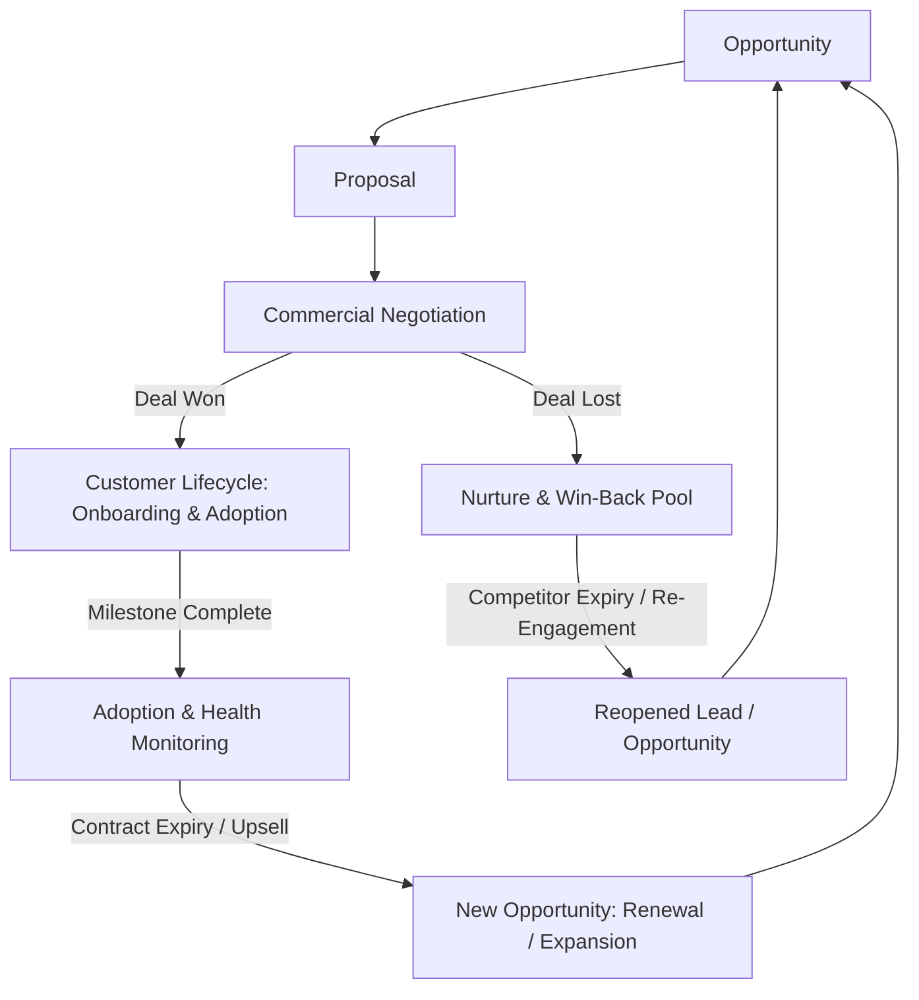

# TEXOL PLD CRM — Post-Negotiation Lifecycle Implementation Plan
**Document Reference:** `TEXOL_Configurable_PLD_CRM_Master_Specification.docx` (Section 5.4) & `Updated_TEXOL_PLD_CRM_VanForces_Functional_Technical_Requirements_v1.1.docx` (Sections 1, 15, 16)

---

## 1. Executive Summary & Specification Context

In both master specification documents, the pipeline does not end at Commercial Negotiation. When a deal reaches a decision point, it branches into two post-negotiation lifecycles:



### Required Post-Negotiation Workspaces:
1. **Customer Lifecycle Workspace (`customer-lifecycle`)**:
   - **For WON Deals**: Manages onboarding delivery, user rollout milestones, telemetry health scores, and contract renewal/expansion triggers.
2. **Nurture & Win-Back Pool (`nurture-pool`)**:
   - **For LOST Deals & Disqualified Leads**: Central holding pool for lost opportunities and nurture leads, tracking loss categories, competitor contracts, and scheduled win-back campaigns.

---

## 2. Technical Architecture & File Inventory

### Files to Create:
| File Path | Description |
|---|---|
| [`frontend/src/components/CustomerLifecycleWorkspace.tsx`](file:///d:/texol/TEXOL%20CRM/frontend/src/components/CustomerLifecycleWorkspace.tsx) | Customer Onboarding, Adoption health, and Renewal/Expansion workspace. |
| [`frontend/src/components/NurtureWorkspace.tsx`](file:///d:/texol/TEXOL%20CRM/frontend/src/components/NurtureWorkspace.tsx) | Closed-lost deal analysis, win-back scheduling, and re-engagement queue. |

### Files to Modify:
| File Path | Modifications Required |
|---|---|
| [`frontend/src/App.tsx`](file:///d:/texol/TEXOL%20CRM/frontend/src/App.tsx) | Add `'customer-lifecycle'` and `'nurture-pool'` to `activeTab` union, update `isTabAllowed()`, add sidebar navigation buttons, and render components. |
| [`frontend/src/services/api.ts`](file:///d:/texol/TEXOL%20CRM/frontend/src/services/api.ts) | Add API interfaces and endpoints for customer lifecycle, renewals, and nurture re-engagement. |
| [`backend/apps/authentication/serializers.py`](file:///d:/texol/TEXOL%20CRM/backend/apps/authentication/serializers.py) | Add `'customer-lifecycle'` and `'nurture-pool'` to `ROLE_WORKSPACE_PERMISSIONS`. |
| [`backend/apps/accounts/views.py`](file:///d:/texol/TEXOL%20CRM/backend/apps/accounts/views.py) | Add endpoints for customer onboarding milestones, health scores, and renewal creation. |
| [`backend/apps/opportunities/views.py`](file:///d:/texol/TEXOL%20CRM/backend/apps/opportunities/views.py) | Add `re_engage` endpoint to revive closed-lost opportunities. |
| [`backend/apps/leads/views.py`](file:///d:/texol/TEXOL%20CRM/backend/apps/leads/views.py) | Add `re_engage` endpoint to restore nurture leads to active contacting. |

---

## 3. Detailed Specifications

### Part 1: Customer Lifecycle Workspace (`customer-lifecycle`)

#### Purpose
Governs post-sale implementation for all accounts with status `CUSTOMER` or opportunities marked `WON`.

#### Key Metrics & KPI Cards:
- **Active Customers Count**: Total accounts with at least one active product.
- **Annual Recurring Revenue (ARR) Under Management**: Sum of `arr_mrr` across customer accounts.
- **Average Customer Health Score**: Percentage health based on telemetry and adoption.
- **Renewals Due in 90 Days**: Number of contracts expiring within 90 days.

#### Sub-Tabs & Capabilities:
1. **Onboarding & Delivery Milestones (`onboarding`)**:
   - Target Go-Live Date and Implementation Scope.
   - Milestone checklist:
     - Kickoff & ERP Connector Requirements (SAP, Oracle, Odoo).
     - Master Data Upload (Depots, Vehicles, Products, Routes).
     - Driver / End-User Mobile Training.
     - Production Go-Live Sign-Off.
   - Progress bar (0% to 100%) and sign-off button.
2. **Product Adoption & Health Telemetry (`adoption`)**:
   - Health score indicator (e.g. 92% - Healthy, 65% - At Risk).
   - Usage indicators:
     - Active Van / Vehicle Seats vs Licensed Seats.
     - Weekly Synced Transactions.
     - Feature Adoption: Offline Barcode Scanning, Geofenced Check-in, Invoice Reconciliation.
3. **Renewals & Expansion Opportunities (`renewals`)**:
   - Days until contract renewal countdown badge.
   - **Trigger Expansion Opportunity**: Button that creates an Opportunity with `opportunity_type = 'EXPANSION'`.
   - **Trigger Contract Renewal**: Button that creates an Opportunity with `opportunity_type = 'RENEWAL'`.

---

### Part 2: Nurture & Win-Back Pool (`nurture-pool`)

#### Purpose
Captures all deals marked `LOST` and leads marked `NURTURE` or `DISQUALIFIED` to prevent deal leakage and enable structured win-back campaigns.

#### Key Metrics & KPI Cards:
- **Total Pipeline in Nurture**: Total contract value of recoverable lost deals.
- **Competitor Losses**: Deals lost specifically to named competitors (e.g., SAP, Geotab).
- **Price Objection Pool**: Deals lost due to budget constraints.
- **Win-Back Candidates (Due This Quarter)**: Deals whose scheduled re-engagement date is reached.

#### Sub-Tabs & Capabilities:
1. **Closed-Lost Opportunities Review (`lost-deals`)**:
   - Filter by Loss Category: `PRICE_BUDGET`, `COMPETITOR_CHOSEN`, `PROJECT_POSTPONED`, `PRODUCT_GAP`, `LEADERSHIP_DECISION`, `PROCUREMENT_LEGAL`.
   - Displays: Account, Product, Total Value, Winning Competitor, Detailed Loss Rationale, Loss Date.
   - Action: **"Schedule Win-Back Campaign"** (sets target re-engagement date).
   - Action: **"Revive Opportunity"** (reopens opportunity to `OPEN` stage).
2. **Disqualified / Nurture Leads (`nurture-leads`)**:
   - Lists leads in `LeadStatus.NURTURE` or `LeadStatus.DISQUALIFIED`.
   - Displays: Company, Contact, Product, Disqualification Reason, Recorded Problems.
   - Action: **"Restore to Active Queue"** (resets lead status to `ACTIVE` and routes to `PLD Lead Queue`).
3. **Loss Intelligence & Competitor Matrix (`intelligence`)**:
   - Visual breakdown of top reasons deals are lost.
   - Competitor leaderboard showing which competitors win against which TEXOL products.

---

## 4. Backend Implementation Details

### 1. Model Support (Already Existing in Codebase)
- [`AccountProduct`](file:///d:/texol/TEXOL%20CRM/backend/apps/accounts/models.py): Contains `status = 'CUSTOMER'`, `contract_value`, `arr_mrr`, `renewal_date`, `health_score`.
- [`Opportunity`](file:///d:/texol/TEXOL%20CRM/backend/apps/opportunities/models.py): Contains `status = 'LOST'`, `loss_reason_category`, `loss_reason_notes`, `competitor`.
- [`Lead`](file:///d:/texol/TEXOL%20CRM/backend/apps/leads/models.py): Contains `status = 'NURTURE'`, `nurture_reason`, `disqualification_reason`.

### 2. New Backend Endpoints Needed

#### In `backend/apps/opportunities/views.py`:
```python
@action(detail=True, methods=['post'], url_path='re-engage')
def re_engage(self, request, pk=None):
    """
    Revives a Closed Lost Opportunity back into the active pipeline.
    """
    opp = self.get_object()
    target_stage_code = request.data.get('stage_code', 'OPP_NEGOTIATION')
    reason = request.data.get('reason', 'Customer requested re-evaluation / competitor contract expired.')
    
    stage = PipelineStage.objects.filter(stage_code=target_stage_code).first()
    opp.status = OpportunityStatus.OPEN
    if stage:
        opp.stage = stage
    opp.loss_reason_category = None
    opp.save(update_fields=['status', 'stage', 'loss_reason_category'])
    
    StageHistory.objects.create(
        record_type='OPPORTUNITY',
        record_id=opp.id,
        to_stage=stage,
        transition_reason=f"Opportunity re-engaged from Nurture: {reason}",
        changed_by=request.user if request.user.is_authenticated else None
    )
    return Response({'message': 'Opportunity reopened successfully.', 'opportunity': OpportunitySerializer(opp).data})
```

#### In `backend/apps/leads/views.py`:
```python
@action(detail=True, methods=['post'], url_path='restore-active')
def restore_active(self, request, pk=None):
    """
    Restores a nurture or disqualified lead back into active pursuit.
    """
    lead = self.get_object()
    lead.status = LeadStatus.ACTIVE
    lead.nurture_reason = None
    lead.disqualification_reason = None
    lead.save(update_fields=['status', 'nurture_reason', 'disqualification_reason'])
    return Response({'message': 'Lead restored to active queue.', 'lead': LeadSerializer(lead).data})
```

#### In `backend/apps/accounts/views.py`:
```python
@action(detail=True, methods=['post'], url_path='create-renewal-opportunity')
def create_renewal_opportunity(self, request, pk=None):
    """
    Generates a Renewal or Expansion Opportunity for an active customer.
    """
    account = self.get_object()
    product_id = request.data.get('product_id')
    opp_type = request.data.get('opportunity_type', 'RENEWAL') # 'RENEWAL' or 'EXPANSION'
    value = request.data.get('value', 0)
    
    product = Product.objects.get(id=product_id)
    opp = Opportunity.objects.create(
        account=account,
        product=product,
        opportunity_type=opp_type,
        status=OpportunityStatus.OPEN,
        total_contract_value=value,
        arr=value,
        arr_mrr=value,
        probability_pct=85
    )
    return Response({'message': f'{opp_type} opportunity created.', 'opportunity_id': str(opp.id)})
```

---

## 5. Frontend Implementation Details

### 1. `frontend/src/services/api.ts` Additions
```typescript
// Customer Lifecycle & Nurture APIs
export interface CustomerProductLifecycle {
  account_id: string;
  account_name: string;
  product_id: string;
  product_name: string;
  contract_value: number;
  arr_mrr: number;
  renewal_date?: string;
  health_score: number;
  onboarding_status: 'IN_PROGRESS' | 'COMPLETED' | 'AT_RISK';
}

// In api object:
reEngageOpportunity: (id: string, data: { reason?: string; stage_code?: string }) =>
  request<{ message: string; opportunity: Opportunity }>(`/opportunities/${id}/re-engage/`, {
    method: 'POST',
    body: JSON.stringify(data)
  }),

restoreNurtureLead: (id: string) =>
  request<{ message: string; lead: Lead }>(`/leads/${id}/restore-active/`, {
    method: 'POST'
  }),

createRenewalOpportunity: (accountId: string, data: { product_id: string; opportunity_type: string; value: number }) =>
  request<{ message: string; opportunity_id: string }>(`/accounts/${accountId}/create-renewal-opportunity/`, {
    method: 'POST',
    body: JSON.stringify(data)
  }),
```

### 2. `frontend/src/App.tsx` Integration
1. Update `activeTab` union state:
   ```typescript
   const [activeTab, setActiveTab] = useState<
     'dashboard' | 'work-queue' | 'account-360' | 'queue' | 'discovery' | 'demo' |
     'poc' | 'sql' | 'opportunities' | 'proposals' | 'negotiation' |
     'customer-lifecycle' | 'nurture-pool' |
     'partners' | 'studio' | 'audit' | 'attribution' | 'leakage' | 'communications' | 'erp' | 'staff-partners'
   >('dashboard');
   ```

2. Update `isTabAllowed()` in `App.tsx`:
   - `'customer-lifecycle'`: Allowed for `ADMIN`, `MANAGEMENT`, `CUSTOMER_SUCCESS`, `SALES_MANAGER`, `ACCOUNT_EXECUTIVE`.
   - `'nurture-pool'`: Allowed for `ADMIN`, `MANAGEMENT`, `MARKETING`, `SALES_MANAGER`, `SALES_BDM`, `PLD_EXECUTIVE`.

3. Sidebar Buttons in `App.tsx` (Placed after `Negotiation Stage`):
   ```tsx
   {/* Customer Lifecycle (Post-Sale Onboarding & Adoption) */}
   {isTabAllowed('customer-lifecycle') && (
     <button 
       className={`btn ${activeTab === 'customer-lifecycle' ? 'btn-primary' : 'btn-outline'}`}
       onClick={() => setActiveTab('customer-lifecycle')}
       style={{ justifyContent: 'flex-start', padding: '8px 12px', fontSize: '0.82rem' }}
     >
       <UserCheck size={16} />
       Customer Lifecycle
     </button>
   )}

   {/* Nurture & Win-Back Pool */}
   {isTabAllowed('nurture-pool') && (
     <button 
       className={`btn ${activeTab === 'nurture-pool' ? 'btn-primary' : 'btn-outline'}`}
       onClick={() => setActiveTab('nurture-pool')}
       style={{ justifyContent: 'flex-start', padding: '8px 12px', fontSize: '0.82rem' }}
     >
       <Archive size={16} />
       Nurture &amp; Win-Back
     </button>
   )}
   ```

4. Render Workspaces in `App.tsx`:
   ```tsx
   {activeTab === 'customer-lifecycle' && (
     <CustomerLifecycleWorkspace
       selectedProductFilter={selectedProductFilter}
       onNavigateToOpportunity={(oppId) => { setSelectedOpportunityId(oppId); setActiveTab('opportunities'); }}
       onNavigateToAccount={(accId) => { setSelectedAccount360Id(accId); setActiveTab('account-360'); }}
     />
   )}

   {activeTab === 'nurture-pool' && (
     <NurtureWorkspace
       selectedProductFilter={selectedProductFilter}
       onNavigateToOpportunity={(oppId) => { setSelectedOpportunityId(oppId); setActiveTab('opportunities'); }}
       onNavigateToLead={(leadId) => { const l = leads.find(x => x.id === leadId); if (l) setSelectedLead(l); setActiveTab('queue'); }}
     />
   )}
   ```

---

## 6. Design & UI Guidelines

All new components must adhere strictly to established design patterns in the codebase:
1. **Modals**: Must use `.modal-overlay` with translucent backdrop (`background: rgba(255, 255, 255, 0.65)`, `backdrop-filter: blur(10px)`) and `.modal-card` centered box.
2. **Alerts**: Zero native `window.alert()` or `window.prompt()`. Use `inAppAlert.success()` and `inAppAlert.error()`.
3. **Cards & Panels**: Use `.glass-panel` container with responsive CSS grid layout.
4. **Icons**: Lucide icons (`UserCheck`, `Archive`, `TrendingUp`, `CheckCircle2`, `Calendar`, `Award`).

---

## 7. Step-by-Step Execution Checklist for the Next Agent

- [ ] **Step 1:** Review this plan document ([`POST_NEGOTIATION_IMPLEMENTATION_PLAN.md`](file:///d:/texol/TEXOL%20CRM/POST_NEGOTIATION_IMPLEMENTATION_PLAN.md)).
- [ ] **Step 2:** Add the backend endpoints in [`backend/apps/opportunities/views.py`](file:///d:/texol/TEXOL%20CRM/backend/apps/opportunities/views.py), [`backend/apps/leads/views.py`](file:///d:/texol/TEXOL%20CRM/backend/apps/leads/views.py), and [`backend/apps/accounts/views.py`](file:///d:/texol/TEXOL%20CRM/backend/apps/accounts/views.py).
- [ ] **Step 3:** Add `'customer-lifecycle'` and `'nurture-pool'` to `ROLE_WORKSPACE_PERMISSIONS` in [`backend/apps/authentication/serializers.py`](file:///d:/texol/TEXOL%20CRM/backend/apps/authentication/serializers.py).
- [ ] **Step 4:** Add API service methods to [`frontend/src/services/api.ts`](file:///d:/texol/TEXOL%20CRM/frontend/src/services/api.ts).
- [ ] **Step 5:** Create [`frontend/src/components/CustomerLifecycleWorkspace.tsx`](file:///d:/texol/TEXOL%20CRM/frontend/src/components/CustomerLifecycleWorkspace.tsx).
- [ ] **Step 6:** Create [`frontend/src/components/NurtureWorkspace.tsx`](file:///d:/texol/TEXOL%20CRM/frontend/src/components/NurtureWorkspace.tsx).
- [ ] **Step 7:** Update [`frontend/src/App.tsx`](file:///d:/texol/TEXOL%20CRM/frontend/src/App.tsx) with tab types, sidebar navigation buttons, and workspace rendering.
- [ ] **Step 8:** Run `npm run build` in `frontend/` to verify zero TypeScript errors.
- [ ] **Step 9:** Test with live browser / curl verification.
