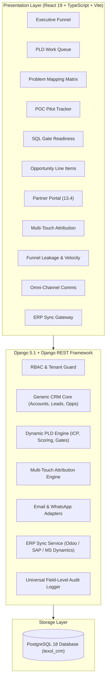

# TEXOL Configurable PLD CRM Platform — System Documentation

> **Primary Source Document:** *TEXOL Configurable PLD CRM Master Specification* & *TEXOL PLD CRM VanForces Functional & Technical Requirements v1.1*  
> **Architecture Version:** 1.2 — Phase 1, 2 & 3 Completed  
> **Guiding Principle:** **The CRM Core is 100% generic.** Products are configurations, never hardcoded code branches or product-specific database tables.

---

## 1. Executive Overview

The **TEXOL Configurable PLD CRM** is an enterprise-grade Revenue Operations and Product-Led Development (PLD) platform designed to support multiple software products, multi-product cross-selling, indirect partner channels, and automated commercial workflows.

### Core Architectural Principle
* **Universal Commercial Core**: Entities such as Accounts, Contacts, Leads, Opportunities, Activities, and Partners are completely product-neutral.
* **Dynamic PLD Engine**: Ideal Customer Profile (ICP) knockouts, problem libraries, capability mappings, scoring dimensions, questionnaire templates, and stage gates are stored as versioned configuration records in PostgreSQL.
* **Zero Hardcoding**: VanForces™ is the first product configuration, but tables like `vanforces_lead` or fields like `van_count` do not exist. Any new product (e.g. TaskForces ERP, EntAura.AI, SpeakOrder) is onboarded purely via database configurations.



---

## 2. Technology Stack

| Layer | Technologies Used |
|---|---|
| **Backend Runtime** | Python 3.14 (Virtualenv), Django 5.1.15, Django REST Framework 3.15 |
| **Database** | PostgreSQL 18 Enterprise DB (`psycopg 3` binary adapter) |
| **Frontend Framework** | React 19, TypeScript (strict mode, `verbatimModuleSyntax`), Vite 8.3 |
| **Styling & Theme** | Custom Slate/Enterprise Dark Theme with Glassmorphism accents ([index.css](file:///d:/texol/TEXOL%20CRM/frontend/src/index.css)) |
| **Icons & Visuals** | Lucide React |
| **API Contract & Docs**| OpenAPI 3.0 via `drf-spectacular` (Interactive Swagger & Redoc) |

---

## 3. What Has Been Built (Phase-by-Phase Breakdown)

### Phase 1: Core Foundation & Dynamic PLD Engine
1. **Modular Architecture (16 Django Apps)**:
   * [`apps.core`](file:///d:/texol/TEXOL%20CRM/backend/apps/core/models.py): Base model with UUID primary keys, audit timestamps, and `tenant_id` for Day-1 multi-tenancy.
   * [`apps.authentication`](file:///d:/texol/TEXOL%20CRM/backend/apps/authentication/models.py): Custom User model with RBAC roles (`ADMIN`, `PLD_SPECIALIST`, `SALES_AE`, `PARTNER_USER`, `EXECUTIVE`).
   * [`apps.products`](file:///d:/texol/TEXOL%20CRM/backend/apps/products/models.py): Product Master, Modules, Capabilities, and Problem Library.
   * [`apps.pld_engine`](file:///d:/texol/TEXOL%20CRM/backend/apps/pld_engine/models.py): Versioned Product Configurations, ICP Rules, Pipeline Stages, Stage Gates, Scoring Models, and Questionnaire engine.
   * [`apps.accounts`](file:///d:/texol/TEXOL%20CRM/backend/apps/accounts/models.py): Organizations, Contacts, and Multi-Product Account relationships.
   * [`apps.leads`](file:///d:/texol/TEXOL%20CRM/backend/apps/leads/models.py): Universal Leads, Multi-Product Interest Matrix, and Problem tags.
2. **PLD Business Logic Engines**:
   * [`ICPEvaluator`](file:///d:/texol/TEXOL%20CRM/backend/apps/pld_engine/services.py#L11-L60): Evaluates knockout rules (hard disqualifiers) and fit rules (tier scoring) dynamically.
   * [`PLDScoreCalculator`](file:///d:/texol/TEXOL%20CRM/backend/apps/pld_engine/services.py#L63-L135): Computes weighted scores across 6 dimensions: Problem Severity (25%), Quantified Value (20%), Decision-Maker Access (15%), ERP Integration Fit (15%), Timeline (15%), Commercial Potential (10%).
   * [`GateValidator`](file:///d:/texol/TEXOL%20CRM/backend/apps/pld_engine/services.py#L138-L210): Enforces evidence requirements before stage transitions can proceed.
3. **Product Seed Data**:
   * **VanForces™ Route Execution**: 6 modules, 5 core capabilities, 6 pre-configured industry problems, 4 stage gates, 6-dimension scoring matrix.
   * **TaskForces ERP**: 4 modules, 3 capabilities, and payroll/HR knockout rules.
   * **EntAura.AI**: 3 modules, 2 capabilities, and transactional data fit rules.

---

### Phase 2: Evaluation, Commercial Lifecycle & Governance
1. **Discovery & Problem Mapping Matrix**:
   * [`Discovery`](file:///d:/texol/TEXOL%20CRM/backend/apps/discovery/models.py) entity mapping identified customer pain points to product capabilities.
   * Interactive UI for Discovery questions and problem-to-capability checklists.
2. **Proof-of-Concept (POC) Pilot Tracker**:
   * [`POCEvaluation`](file:///d:/texol/TEXOL%20CRM/backend/apps/evaluations/models.py) with 30-day baseline vs. pilot KPI tracking (e.g. Route adherence: 58% baseline ➔ 88% pilot result; Order time: 45m ➔ 8m).
3. **SQL Gate Readiness & Sales Acceptance (Wireframe 13.7)**:
   * [`SQLHandoff`](file:///d:/texol/TEXOL%20CRM/backend/apps/sales_handoff/models.py) formal handshake between PLD Specialist and Sales AE.
   * 48-hour SLA countdown, Accept/Reject workflow, and mandatory rejection reasoning.
4. **Multi-Product Opportunities Pipeline**:
   * [`Opportunity`](file:///d:/texol/TEXOL%20CRM/backend/apps/opportunities/models.py) with [`OpportunityProductLine`](file:///d:/texol/TEXOL%20CRM/backend/apps/opportunities/models.py) supporting multi-product bundles and cross-sell line items.
5. **Partner Portal (Wireframe 13.4)**:
   * [`Partner`](file:///d:/texol/TEXOL%20CRM/backend/apps/partners/models.py), [`PartnerProduct`](file:///d:/texol/TEXOL%20CRM/backend/apps/partners/models.py) authorization, and [`DealRegistration`](file:///d:/texol/TEXOL%20CRM/backend/apps/partners/models.py).
   * 90-day deal protection window and automated duplicate conflict review.
6. **Universal Field-Level Audit Trail**:
   * [`AuditLog`](file:///d:/texol/TEXOL%20CRM/backend/apps/audit_logging/models.py) recording actor, timestamp, IP address, and JSON diffs of old vs. new values across all model mutations.

---

### Phase 3: Multi-Touch Attribution, Omni-Channel Comms & ERP Sync
1. **Multi-Touch Campaign Attribution Engine**:
   * [`MultiTouchAttributionEngine`](file:///d:/texol/TEXOL%20CRM/backend/apps/integrations/attribution_engine.py#L16-L144): Dynamic algorithmic attribution supporting W-Shaped, First-Touch, Last-Touch, Linear, and Partner-Weighted models.
   * Inbound Webhook endpoint (`/api/v1/integrations/inbound-lead/`) for campaign ingestion (Google Ads, LinkedIn, Meta).
   * UI: [MultiTouchAttributionView.tsx](file:///d:/texol/TEXOL%20CRM/frontend/src/components/MultiTouchAttributionView.tsx) with live ROAS indicators, channel visualizer, and webhook test simulator.
2. **Funnel Leakage & Pipeline Velocity Diagnostics**:
   * [`FunnelLeakageVelocityView`](file:///d:/texol/TEXOL%20CRM/backend/apps/analytics/views.py#L73-L179): 5-stage conversion waterfall, volume drop-off counts, primary disqualification causes, stage dwell times, active SLA watchdog, and loss Pareto distribution.
   * UI: [FunnelLeakageVelocityView.tsx](file:///d:/texol/TEXOL%20CRM/frontend/src/components/FunnelLeakageVelocityView.tsx).
3. **Omni-Channel Communications Hub**:
   * [`EmailNotificationAdapter`](file:///d:/texol/TEXOL%20CRM/backend/apps/integrations/adapters.py#L76-L100) & [`WhatsAppNotificationAdapter`](file:///d:/texol/TEXOL%20CRM/backend/apps/integrations/adapters.py#L103-L125) delivering automated alerts (`SQL_READY`, `DEAL_PROTECTION_CONFIRMED`, `POC_COMPLETED`).
   * [`CommunicationMessage`](file:///d:/texol/TEXOL%20CRM/backend/apps/integrations/models.py#L29-L60) delivery ledger tracking `SENT`, `DELIVERED`, and `READ` statuses.
   * UI: [OmniChannelCommsView.tsx](file:///d:/texol/TEXOL%20CRM/frontend/src/components/OmniChannelCommsView.tsx).
4. **ERP Customer Master Integration Gateway**:
   * [`ERPConnectorConfig`](file:///d:/texol/TEXOL%20CRM/backend/apps/integrations/models.py#L76-L98) with connectors for **Odoo 17 Enterprise**, **SAP Business One**, and **Microsoft Dynamics 365**.
   * [`ERPSyncService`](file:///d:/texol/TEXOL%20CRM/backend/apps/integrations/erp_service.py#L8-L78): Push account action, validation conflict detection (tax/VAT number, postal city), and resolution workflows (`CRM_WINS` vs `ERP_WINS`).
   * UI: [ERPSyncGatewayView.tsx](file:///d:/texol/TEXOL%20CRM/frontend/src/components/ERPSyncGatewayView.tsx).

---

## 4. Frontend Workspaces Map

The React single-page application ([App.tsx](file:///d:/texol/TEXOL%20CRM/frontend/src/App.tsx)) is organized into 11 dedicated enterprise workspaces:

```
TEXOL CRM
├── 1. Executive Funnel           # Overall pipeline value, won revenue, conversion rates, product breakdown
├── 2. PLD Work Queue             # Single-screen qualification, 6-dimension score breakdown, gate readiness
├── 3. Discovery & Mapping        # Customer pain-point mapping to product capabilities with gate checks
├── 4. POC Pilot Trials           # Pilot execution tracker, baseline vs result KPI metrics
├── 5. SQL Gate Readiness         # Wireframe 13.7 Sales Acceptance, 48h SLA timer, Accept/Reject actions
├── 6. Opportunities              # Multi-product line items, deal stage, contract values
├── 7. Multi-Touch Attribution    # Dynamic attribution models (W-Shaped/First/Last/Linear), ROAS, Webhook simulator
├── 8. Funnel Leakage & Velocity  # Drop-off waterfall, stage dwell velocity, active SLA watchdog, Pareto loss
├── 9. Omni-Channel Comms         # Email & WhatsApp notifications, interactive message dispatcher, delivery log
├── 10. ERP Customer Sync         # Odoo/SAP/Dynamics connectors, bi-directional sync ledger, conflict resolution
├── 11. Partner Portal            # Wireframe 13.4 partner deals, 90-day protection window, commission accrued
├── 12. Product Studio            # Inspector for versioned product configurations, modules, gates
└── 13. Universal Audit Trail     # Immutable chronological log of all field modifications
```

---

## 5. Key REST API Endpoints

All endpoints are versioned under `/api/v1/`:

| Module | Method | Endpoint | Description |
|---|---|---|---|
| **Products** | `GET` | `/api/v1/products/` | List all dynamic product configurations |
| **PLD Engine** | `POST` | `/api/v1/configurations/validate-gate/` | Check gate requirements before stage progression |
| **Leads** | `GET, POST`| `/api/v1/leads/` | Lead intake, filtering by product scope |
| **Leads** | `POST` | `/api/v1/leads/{id}/transition-stage/` | Evidence-driven stage progression with audit |
| **Discovery** | `POST` | `/api/v1/discoveries/{id}/complete-mapping/` | Commit problem-to-capability mappings |
| **SQL Handoff**| `POST` | `/api/v1/sql-handoffs/{id}/accept/` | Sales AE acceptance (auto-creates Opportunity) |
| **SQL Handoff**| `POST` | `/api/v1/sql-handoffs/{id}/reject/` | Sales rejection with mandatory reason |
| **Opportunities**| `GET` | `/api/v1/opportunities/` | Opportunity pipeline with multi-product line items |
| **Partners** | `GET` | `/api/v1/partner-portal/dashboard/` | Wireframe 13.4 Partner Portal KPI dashboard |
| **Partners** | `POST` | `/api/v1/deal-registrations/` | Submit deal with duplicate conflict check |
| **Partners** | `POST` | `/api/v1/deal-registrations/{id}/accept/`| Grant 90-day protected exclusivity window |
| **Attribution** | `GET` | `/api/v1/integrations/attribution/?model=` | Re-calculate multi-touch attribution on-the-fly |
| **Webhook** | `POST` | `/api/v1/integrations/inbound-lead/` | Inbound campaign form ingestion & auto-ICP |
| **Analytics** | `GET` | `/api/v1/analytics/leakage-velocity/` | Funnel waterfall, stage velocity & SLA alerts |
| **Comms** | `GET` | `/api/v1/communications/` | Unified Email & WhatsApp delivery ledger |
| **Comms** | `POST` | `/api/v1/communications/send-test/` | Dispatch templated Email or WhatsApp alert |
| **ERP** | `GET` | `/api/v1/erp-connectors/` | List configured ERP systems (Odoo, SAP, Dynamics) |
| **ERP** | `POST` | `/api/v1/erp-connectors/{id}/sync-account/`| Outbound push of customer master to ERP |
| **ERP** | `POST` | `/api/v1/erp-connectors/resolve-conflict/` | Resolve ERP validation/tax conflicts |
| **Audit** | `GET` | `/api/v1/audit-logs/` | Chronological field-level audit log |
| **OpenAPI** | `GET` | `/api/docs/` | Interactive Swagger UI API Documentation |

---

## 6. How to Run Locally

### Backend (Django 5 + PostgreSQL 18)
```bash
# Navigate to backend directory
cd "d:\texol\TEXOL CRM\backend"

# Activate virtual environment
.\venv\Scripts\Activate.ps1

# Run migrations (already applied)
python manage.py migrate

# Seed Phase 1, Phase 2, and Phase 3 master data
python seed_phase3.py

# Start development server on port 8001
python manage.py runserver 8001
```

### Frontend (React 19 + TypeScript + Vite)
```bash
# Navigate to frontend directory
cd "d:\texol\TEXOL CRM\frontend"

# Build production bundle to verify types
npm run build

# Start Vite dev server on port 5173
npm run dev -- --host
```

Access the application in your browser at: **`http://localhost:5173/`**  
Access the interactive Swagger API documentation at: **`http://localhost:8001/api/docs/`**
