# TEXOL PLD CRM — Comprehensive Data Dictionary & Field Guide

This document provides a complete specification of all data fields, column definitions, data types, validation rules, and business descriptions across every page, workspace, modal, and data table in the **TEXOL Product-Led Distribution (PLD) CRM**.

---

## Table of Contents
1. [PLD Lead Queue & Intake Workspace](#1-pld-lead-queue--intake-workspace)
2. [PLD Qualification & ICP Assessment Workspace](#2-pld-qualification--icp-assessment-workspace)
3. [Discovery & Capability Mapping Workspace](#3-discovery--capability-mapping-workspace)
4. [Product Demo Workspace](#4-product-demo-workspace)
5. [Proof of Concept (POC) Pilot Trials Workspace](#5-proof-of-concept-poc-pilot-trials-workspace)
6. [SQL Gate Readiness & Handoff Workspace](#6-sql-gate-readiness--handoff-workspace)
7. [Sales Acceptance & Rejection Workspace](#7-sales-acceptance--rejection-workspace)
8. [Commercial Opportunity Workspace](#8-commercial-opportunity-workspace)
9. [Commercial Proposals & Pricing Quotes Workspace](#9-commercial-proposals--pricing-quotes-workspace)
10. [My Work Queue & SLA Dashboard](#10-my-work-queue--sla-dashboard)
11. [Account 360 Workspace](#11-account-360-workspace)
12. [Product Studio & PLD Engine Admin](#12-product-studio--pld-engine-admin)
13. [Partner Portal & Channel Management](#13-partner-portal--channel-management)
14. [Analytics, Attribution, Funnel Velocity & ERP Sync Gateway](#14-analytics-attribution-funnel-velocity--erp-sync-gateway)
15. [Universal Audit Trail & Activity Timeline](#15-universal-audit-trail--activity-timeline)
16. [Cross-Stage Data Continuity Matrix](#16-cross-stage-data-continuity-matrix)

---

## 1. PLD Lead Queue & Intake Workspace

### Purpose
The **PLD Lead Queue** (`LeadQueue.tsx`) serves as the central hub for PLD Executives and Inbound SDRs. It lists all inbound prospects, marketing leads, partner referrals, and website inquiries awaiting initial qualification, SLA response, or progression to Discovery.

### Tables & Columns

| Column / Field Name | Model & Field Key | Data Type & Choices | Req / Opt | Functional Description & Usage |
| :--- | :--- | :--- | :--- | :--- |
| **Account Name** | `Lead.account.company_name` | Text (255) / Link | **Required** | The legal or trading name of the prospective organization (e.g., *Al-Marai Logistics*, *Gulf Food Distributors*). Clicking opens Account 360. |
| **Contact Person** | `Lead.contact.first_name` + `last_name` | Text / Email / Phone | Optional | The primary customer contact person initiating the inquiry (e.g., Fleet Manager, Head of Operations, CIO). |
| **Primary Product** | `Lead.primary_product.code` | Enum (`VANFORCES`, `TASKFORCES`, `ENTAURA`, `AL_MAWASIL`, `SPEAKORDER`) | **Required** | The primary software product the prospect inquired about or is being evaluated for. Determines product-specific ICP rules. |
| **Lead Status** | `Lead.status` | Enum: `ACTIVE`, `NURTURE`, `DISQUALIFIED`, `CONVERTED` | **Required** | Current operational status of the lead:  • **Active**: Under active qualification. • **Nurture**: Not ready now; automated re-engagement scheduled. • **Disqualified**: Knocked out by ICP or no budget. • **Converted**: Successfully accepted as SQL into Sales. |
| **Current Stage** | `Lead.current_stage.stage_name` | Text (Foreign Key) | **Required** | The exact pipeline stage the lead is currently in: *Lead Intake*, *PLD Qualification*, *Discovery & Mapping*, *Product Demo*, *POC Trial*, or *SQL Handoff*. |
| **PLD Fit Score** | `AccountProductAssessment.total_score` | Integer (0 – 100) | Auto | The real-time composite qualification score calculated from ICP criteria, problem severity, and questionnaire responses. Color coded: Green (80+ High Priority), Blue (60-79 Qualified), Yellow (30-59 Development), Red (<30 Nurture). |
| **Lead Source** | `Lead.source.name` | Foreign Key / Text | Optional | Channel where the lead originated: `Website Inbound`, `LinkedIn Ads`, `Direct Referral`, `ERP Partner`, `Cold Outreach`, `Webinar`. |
| **Partner Originator** | `Lead.partner.account.company_name` | Foreign Key / Link | Optional | If originated or registered by a partner (e.g., *Odoo Silver Partner*), displays partner company and protects deal attribution. |
| **Est. Opportunity Value** | `Lead.estimated_opportunity_value` | Decimal (12,2) Currency | Optional / Required for SQL | The estimated total contract value in SAR/USD based on anticipated license count or initial discovery estimates. |
| **Next Action** | `Lead.next_action_description` | Text (255) | **Required** | Mandatory next scheduled operational task (e.g., *Schedule discovery call with Operations Director*). Cannot be empty while status is Active. |
| **Next Action Due Date** | `Lead.next_activity_due_at` | DateTime | **Required** | Due timestamp for the next action. Powers the SLA countdown timer and automated escalation alerts. |
| **SLA Status** | Computed (`SLATracker.status`) | Badge: `WITHIN_SLA`, `DUE_SOON`, `AT_RISK`, `BREACHED` | Auto | Visual indicator showing whether the first response or stage milestone SLA has elapsed. Breached SLAs highlight in flashing red. |

---

## 2. PLD Qualification & ICP Assessment Workspace

### Purpose
The **PLD Qualification Workspace** (`PLDQualificationWorkspace.tsx`) is where PLD Executives evaluate whether a prospective account matches the Ideal Customer Profile (ICP), document initial business problems, fill out product questionnaires, and advance the lead to Discovery.

### Section A: Lead Information Header
| Field Name | Model & Field Key | Data Type | Req / Opt | Functional Description |
| :--- | :--- | :--- | :--- | :--- |
| **Lead Reference ID** | `Lead.id` | UUID (e.g., `#a71b2e9c`) | Read-only | Unique internal UUID used across API payloads and audit trails. |
| **Company & Industry** | `Account.company_name`, `Account.industry` | Text | Read-only | Displays organization name and industry sector (e.g., *FMCG & Food Distribution*). |
| **Target Product Badge** | `Product.name` (`Product.code`) | Badge | Read-only | Displays target product edition (e.g., *VanForces Route Pro*). |
| **Assigned Owner** | `Lead.owner.email` | User Selector | Optional | PLD Specialist responsible for qualifying this prospect. |

### Section B: Product-Specific ICP Evaluation Card
| Field Name | Model & Field Key | Data Type & Choices | Req / Opt | Functional Description |
| :--- | :--- | :--- | :--- | :--- |
| **Field Sales / Van Fleet Active** | `AccountAttribute.attribute_value['field_sales']` | Boolean (`Yes` / `No`) | **Required** | Indicates if the prospect operates van sales or field dispatchers. Mandatory knock-out for VanForces. |
| **Number of Active Delivery Vans** | `Account.distribution_centers_count`, `vans_count` | Positive Integer | **Required** | Fleet size. Minimum threshold (e.g., 5+ vans) required to satisfy VanForces ICP rules. |
| **Field Salesmen Count** | `AccountAttribute.attribute_value['salesmen_count']` | Positive Integer | **Required** | Number of field sales reps. Drives seat-based pricing and volume tiers. |
| **Primary Current ERP / Accounting** | `AccountAttribute.attribute_value['primary_erp']` | Select (`SAP`, `Odoo`, `Oracle`, `Dynamics`, `Excel/Manual`) | **Required** | Existing software system. Used to evaluate connector readiness and API compatibility. |
| **ICP Evaluation Status** | `AccountProductAssessment.icp_status` | Badge: `PASSED`, `KNOCKED_OUT`, `PENDING` | Auto | Real-time result of rule engine evaluation against configured ICP rules. |

### Section C: Dynamic Qualification Questionnaire
| Field Name | Model & Field Key | Data Type & Choices | Req / Opt | Functional Description |
| :--- | :--- | :--- | :--- | :--- |
| **Question Title** | `QuestionnaireQuestion.question_text` | Text (500) | System | Configurable question loaded dynamically from the product's active version template. |
| **Answer Options** | `QuestionAnswerOption.label` | Select / Radio / Checkbox | Optional | Configurable answer choices with point weights (e.g., *Daily Reconciliation: 100 pts*, *Manual End-of-Week: 30 pts*). |
| **Add Custom Option** | `QuestionAnswerOption.value` + `points` | Inline Form (Label, Points) | Optional | Admin/specialist capability to add missing operational choices on-the-fly. |
| **Questionnaire Score** | `AccountProductAssessment.questionnaire_score` | Integer (0 – 100) | Auto | Weighted composite score computed from answered questions. Feeds PLD fit score. |

### Section D: Documented Business Problems Table
| Column Name | Model & Field Key | Data Type & Choices | Req / Opt | Functional Description |
| :--- | :--- | :--- | :--- | :--- |
| **Problem Name** | `Problem.name` | Select or Custom Text | **Required** | Identified business issue (e.g., *Van Stock Discrepancies & Cash Leakage*, *Paper Invoice Loss*). |
| **Problem Category** | `LeadProblem.category` | Enum: `DISTRIBUTION`, `SALES`, `OPERATIONS`, `MANAGEMENT`, `INTEGRATION`, `COMPLIANCE` | **Required** | Operational operational category for domain tagging. |
| **Severity** | `LeadProblem.severity` | Enum: `LOW`, `MEDIUM`, `HIGH`, `CRITICAL` | **Required** | Urgency and impact level. High and Critical carry higher weight in PLD scoring. |
| **Frequency** | `LeadProblem.frequency` | Enum: `DAILY`, `WEEKLY`, `MONTHLY`, `OCCASIONAL` | **Required** | How often the problem occurs in field operations. |
| **Quantified Business Impact** | `LeadProblem.business_impact` | Text Area | Optional | Estimated financial or operational loss (e.g., *Estimated 45,000 SAR monthly uncollected cash*). |
| **Affected Users / Personas** | `LeadProblem.affected_users` | Text (255) | Optional | Stakeholders impacted (e.g., *28 Van Drivers, 2 Warehouse Supervisors, Head of Credit*). |
| **Evidence & Notes** | `LeadProblem.evidence`, `notes` | Text Area | Optional | Quotes, customer reports, or ERP reconciliation discrepancies observed. |

### Section E: Stage Gate Checklist & Stage Progression
| Field Name | Model & Field Key | Data Type | Req / Opt | Functional Description |
| :--- | :--- | :--- | :--- | :--- |
| **ICP Knockout Gate** | Gate rule check | Boolean Badge (`Pass` / `Fail`) | Auto | Confirms all mandatory ICP knockout rules have been passed. |
| **Problem Severity Gate** | Gate rule check | Boolean Badge (`Pass` / `Fail`) | Auto | Confirms at least 1 high-severity problem has been documented. |
| **Score Threshold Gate** | Gate rule check | Boolean Badge (`Pass` / `Fail`) | Auto | Confirms composite PLD score exceeds stage threshold (typically 40+ for Discovery). |
| **Advance to Discovery Button** | Action Trigger | Action Button | User Action | Progresses lead to Discovery workspace and transitions pipeline stage to *Discovery & Mapping*. |

---

## 3. Discovery & Capability Mapping Workspace

### Purpose
The **Discovery Workspace** (`DiscoveryWorkspace.tsx`) is used to run structured discovery workshops. It documents operational processes, refines customer problems, maps buying committee stakeholders, and enforces the mandatory **Product Capability Mapping Gate** before product demos.

### Tables & Columns

| Section / Table | Column / Field Name | Model & Field Key | Data Type & Choices | Req / Opt | Functional Description & Usage |
| :--- | :--- | :--- | :--- | :--- | :--- |
| **Session Info** | **Discovery ID** | `Discovery.id` | UUID | Auto | Unique discovery session identifier. |
| **Session Info** | **Conducted By** | `Discovery.conducted_by` | User Foreign Key | **Required** | PLD Solution Specialist or Presales Engineer leading the discovery workshop. |
| **Session Info** | **Discovery Status** | `Discovery.status` | Enum: `IN_PROGRESS`, `COMPLETED`, `CANCELLED` | **Required** | Stage status. Cannot be marked `COMPLETED` until all confirmed problems are mapped to capabilities. |
| **Operational Process** | **Current Operational Process Notes** | `Discovery.current_process_notes` | Rich Text Area | **Required** | Step-by-step documentation of current manual/legacy workflow (e.g., *Drivers manually write triplicate receipts; daily warehouse returns reconciled by hand next morning*). |
| **Operational Process** | **Business Impact Summary** | `Discovery.business_impact_summary` | Rich Text Area | Optional | Strategic summary of executive impact: operational bottleneck, revenue leakage, or compliance risk. |
| **Buying Committee** | **Stakeholder Contact** | `DiscoveryStakeholder.contact` | Contact Foreign Key | **Required** | Customer individual interviewed or attending the workshop. |
| **Buying Committee** | **Role Title** | `DiscoveryStakeholder.role_name` | Text (128) | Optional | Specific operational title (e.g., *VP Supply Chain*, *IT Infrastructure Manager*). |
| **Buying Committee** | **Decision Role** | `DiscoveryStakeholder.decision_role` | Enum: `DECISION_MAKER`, `CHAMPION`, `INFLUENCER`, `TECHNICAL`, `FINANCE`, `USER` | **Required** | Role in the buying decision committee. Required to verify Economic Decision Maker access. |
| **Buying Committee** | **Influence Level** | `DiscoveryStakeholder.involvement_level` | Enum: `HIGH`, `MEDIUM`, `LOW` | **Required** | Degree of influence over final purchase approval. |
| **Process & Timeline** | **Decision Process Notes** | `Discovery.decision_process_notes` | Text Area | Optional | Documented procurement stages, Board approval thresholds, and legal review requirements. |
| **Process & Timeline** | **Target Decision Date** | `Discovery.expected_decision_date` | Date | Optional | Expected target date when executive sign-off is planned. |
| **Process & Timeline** | **Target Go-Live Date** | `Discovery.expected_implementation_date` | Date | Optional | Customer's desired deployment deadline or fiscal quarter rollout window. |
| **Financial & Infra** | **Budget Notes & Range** | `Discovery.budget_notes` | Text (255) | Optional | Confirmed budget envelope or fiscal year budget line status. |
| **Financial & Infra** | **Technical Constraints Notes** | `Discovery.technical_constraints_notes` | Text Area | Optional | Infrastructure limits (e.g., *Offline van mode required; integration needed with on-premise SAP ECC 6.0*). |
| **Refined Problems** | **Refined Problem Statement** | `DiscoveryProblem.refined_statement` | Text (255) | **Required** | Contextualized definition of the problem within this customer's specific operational environment. |
| **Refined Problems** | **Quantified Loss Value** | `DiscoveryProblem.quantified_loss_value` | Decimal Currency | Optional | Documented annualized financial loss (e.g., *320,000 SAR annual inventory shrinkage*). |
| **Refined Problems** | **Problem Severity & Frequency** | `DiscoveryProblem.severity`, `frequency` | Enums: `CRITICAL/HIGH/MED/LOW`, `DAILY/WEEKLY/...` | **Required** | Confirmed severity and occurrence rate. |
| **Refined Problems** | **Is Confirmed Problem** | `DiscoveryProblem.is_confirmed` | Boolean Checkbox | **Required** | Checked if verified with customer stakeholders as an active pain point requiring resolution. |
| **Capability Mapping** | **Product Module** | `ProductModule.name` | Foreign Key / Text | **Required** | Specific product module delivering the solution (e.g., *Van Sales Execution Module*). |
| **Capability Mapping** | **Product Capability** | `DiscoveryProblemMapping.capability` | Foreign Key / Text | **Required** | Exact technical capability resolving the problem (e.g., *Offline Geofenced Cash Collection & Invoice Printing*). |
| **Capability Mapping** | **Expected KPI Impact** | `DiscoveryProblemMapping.expected_kpi_impact` | Text (255) | Optional | Measurable target outcome (e.g., *100% real-time cash reconciliation, 0 paper receipts lost*). |

---

## 4. Product Demo Workspace

### Purpose
The **Demo Workspace** (`DemoWorkspace.tsx`) structures end-to-end product demonstrations. It links demonstrated capabilities directly back to Discovery problems, logs attendee participation, captures customer sentiment, and records objections.

### Tables & Columns

| Section / Table | Column / Field Name | Model & Field Key | Data Type & Choices | Req / Opt | Functional Description & Usage |
| :--- | :--- | :--- | :--- | :--- | :--- |
| **Session Header** | **Demo Session ID** | `Demo.id` | UUID | Auto | Unique identifier for the demo event. |
| **Session Header** | **Target Product** | `Demo.product.name` | Foreign Key | **Required** | Product demonstrated (e.g., *VanForces Route Pro Edition*). |
| **Session Header** | **Presenter** | `Demo.presenter` | User Foreign Key | **Required** | Solution Architect or Presales Engineer who gave the live demonstration. |
| **Session Header** | **Scheduled At** | `Demo.scheduled_at` | DateTime | **Required** | Date and time the demo was scheduled. |
| **Session Header** | **Conducted At** | `Demo.conducted_at` | DateTime | Optional | Timestamp when the demo session was actually completed. |
| **Session Header** | **Demo Status** | `Demo.status` | Enum: `SCHEDULED`, `COMPLETED`, `CANCELLED`, `NOT_REQUIRED` | **Required** | Operational status of the demo. `NOT_REQUIRED` requires documenting justification. |
| **Participants** | **Participant Name** | `DemoParticipant.name` | Text (255) | **Required** | Attendee full name. |
| **Participants** | **Participant Type** | `DemoParticipant.participant_type` | Enum: `CUSTOMER`, `INTERNAL` | **Required** | Identifies customer stakeholder vs. internal TEXOL attendee. |
| **Participants** | **Role Title** | `DemoParticipant.role_title` | Text (128) | Optional | Attendee designation (e.g., *Operations Director*, *Fleet Supervisor*). |
| **Participants** | **Attended Checkbox** | `DemoParticipant.attended` | Boolean Checkbox | **Required** | Tracks attendance for buyer engagement scoring. |
| **Use Cases Demonstrated** | **Discovery Problem** | `DemoUseCaseMapping.discovery_problem` | Foreign Key | **Required** | Discovery pain point being proven solved in this demo. |
| **Use Cases Demonstrated** | **Product Capability** | `DemoUseCaseMapping.capability` | Foreign Key | **Required** | The software capability demonstrated to solve the pain point. |
| **Use Cases Demonstrated** | **Was Demonstrated** | `DemoUseCaseMapping.was_demonstrated` | Boolean Checkbox | **Required** | Confirms whether this capability was successfully demonstrated during the live session. |
| **Use Cases Demonstrated** | **Customer Reaction Notes** | `DemoUseCaseMapping.notes` | Text Area | Optional | Customer reactions, questions, or specific praise regarding this feature. |
| **Evaluation & Feedback** | **Fit Assessment** | `Demo.fit_assessment` | Enum: `STRONG` (Strong Fit), `MODERATE` (Moderate Fit), `POOR` (Poor Fit) | **Required** | Presenter's technical and operational fit rating based on demo interaction. |
| **Evaluation & Feedback** | **Customer Feedback** | `Demo.customer_feedback` | Rich Text Area | **Required** | Customer's direct evaluation and verbatim feedback on the solution shown. |
| **Evaluation & Feedback** | **Objections Raised** | `Demo.objections_raised` | Text Area | Optional | Documented customer objections, gaps, or security/IT concerns. |
| **Evaluation & Feedback** | **Customer Questions** | `Demo.customer_questions` | Text Area | Optional | Technical or commercial questions posed by the customer committee. |
| **Evaluation & Feedback** | **Customer Overall Response** | `Demo.customer_response` | Text Area | Optional | Committee sentiment and indicated readiness to proceed to POC or Proposal. |
| **Next Action** | **Next Action Description** | `Demo.next_action_description` | Text (255) | **Required** | Mandatory next step (e.g., *Draft POC success criteria charter with IT Lead*). |
| **Next Action** | **Next Action Due Date** | `Demo.next_action_due_at` | DateTime | **Required** | Due timestamp enforcing follow-up SLAs. |

---

## 5. Proof of Concept (POC) Pilot Trials Workspace

### Purpose
The **POC Workspace** (`POCWorkspace.tsx`) governs production pilot trials. It establishes pilot boundaries (users, vans, geography), tracks measurable success criteria KPIs against historical baselines, and logs weekly trial check-ins.

### Tables & Columns

| Section / Table | Column / Field Name | Model & Field Key | Data Type & Choices | Req / Opt | Functional Description & Usage |
| :--- | :--- | :--- | :--- | :--- | :--- |
| **Trial Setup** | **Pilot Scope Description** | `POC.scope_description` | Text Area | **Required** | Exact operational boundaries of the pilot (e.g., *5 Distribution Vans, Riyadh Central Route, 150 Retail Outlets*). |
| **Trial Setup** | **Active Pilot Users / Seats** | `POC.users_count` | Positive Integer | **Required** | Number of active pilot drivers/users operating the mobile software. |
| **Trial Setup** | **Geographic Coverage** | `POC.geography_coverage` | Text (255) | Optional | Territory or depot location (e.g., *Riyadh Central Distribution Center*). |
| **Trial Setup** | **Pilot Start Date** | `POC.start_date` | Date | **Required** | Date mobile software goes live in the field. |
| **Trial Setup** | **Pilot End Date** | `POC.end_date` | Date | **Required** | Formal trial cutoff date. |
| **Trial Setup** | **POC Status** | `POC.status` | Enum: `PLANNED`, `ACTIVE`, `REVIEW`, `COMPLETED`, `FAILED`, `CANCELLED`, `NOT_REQUIRED` | **Required** | Operational progress state of the pilot trial. |
| **Success Criteria** | **Criterion Name** | `POCSuccessCriterion.name` | Text (255) | **Required** | Documented metric being measured (e.g., *Daily Van Cash Reconciliation Time*, *Invoice Return Discrepancy*). |
| **Success Criteria** | **Category** | `POCSuccessCriterion.category` | Enum: `OPERATIONAL`, `FINANCIAL`, `TECHNICAL`, `USER_ADOPTION` | Optional | Metric domain category. |
| **Success Criteria** | **Measurement Baseline** | `POCSuccessCriterion.measurement_baseline` | Text (255) | **Required** | Current pre-pilot performance benchmark (e.g., *3.5 hours per van at end of day*). |
| **Success Criteria** | **Target Success Threshold** | `POCSuccessCriterion.expected_target` | Text (255) | **Required** | Contractually agreed threshold for POC success (e.g., *Under 25 minutes per van*). |
| **Success Criteria** | **Actual Achieved Result** | `POCSuccessCriterion.actual_result` | Text (255) | Required at close | Result recorded during trial completion (e.g., *18 minutes average per van*). |
| **Success Criteria** | **Is Met Checkbox** | `POCSuccessCriterion.is_met` | Boolean Checkbox | Required at close | Confirms whether measured outcome met or exceeded the agreed target. |
| **Participants** | **Participant Name & Role** | `POCParticipant.name`, `role_title` | Text (255) | **Required** | Field supervisor or pilot driver participating in trial. |
| **Weekly Check-ins** | **Milestone Notes & Health** | `POC.baseline_notes`, `results_summary` | Rich Text Area | Optional | Health check updates, driver usability feedback, and sync reliability. |
| **Final Trial Verdict** | **Is Successful Checkbox** | `POC.status == 'COMPLETED'` | Boolean Checkbox | **Required** | Formal sign-off that trial fulfilled commercial and technical criteria. |
| **Final Trial Verdict** | **Results Summary** | `POC.results_summary` | Text Area | **Required** | Evidence summary to be presented in SQL Sales Acceptance and Proposal. |

---

## 6. SQL Gate Readiness & Handoff Workspace

### Purpose
The **SQL Readiness Workspace** (`SQLReadinessWorkspace.tsx`) serves as the strict quality gate between PLD presales and Commercial Account Executives. It evaluates 9 evidence-based criteria before allowing a lead to be submitted for Sales Acceptance.

### The 9 SQL Gates Evaluated
| Gate # | Gate Name | Technical Field Key | Evaluation Criterion | Mandatory? |
| :---: | :--- | :--- | :--- | :---: |
| **1** | **ICP Fit Verified** | `icp_fit_verified` | Account operational criteria match target product profile; zero knockout failures. | **Yes** |
| **2** | **Pain Quantified** | `pain_quantified` | At least 1 high-severity problem confirmed with quantified operational or financial loss. | **Yes** |
| **3** | **Decision Maker Engaged** | `decision_maker_engaged` | Confirmed Economic Decision Maker or Champion identified in Buying Committee. | **Yes** |
| **4** | **Budget Confirmed** | `budget_confirmed` | Stated budget range or approved capital expenditure verified with client. | **Yes** |
| **5** | **Timeline Confirmed** | `timeline_confirmed` | Target decision date and implementation window documented. | **Yes** |
| **6** | **Demo Completed** | `demo_completed` | Product demonstration conducted, use cases mapped, and fit assessed as Strong/Moderate. | **Yes** (or Skipped) |
| **7** | **POC Successful** | `poc_successful` | POC completed with verified criteria met, or stage formally bypassed as Not Required. | **Yes** (or Skipped) |
| **8** | **Technical Feasibility** | `technical_feasibility_cleared` | ERP connectors, mobile OS versions, and network constraints cleared by presales. | **Yes** |
| **9** | **Partner Alignment** | `partner_aligned` | If partner-sourced, partner registration verified and commission structure confirmed. | **Yes** |

### Submission Columns & Form Fields
| Field Name | Model & Field Key | Data Type & Choices | Req / Opt | Functional Description & Usage |
| :--- | :--- | :--- | :--- | :--- |
| **Assigned Sales Owner** | `SQLHandoff.assigned_sales_owner` | User Selector (Role: Sales / AE) | **Required** | The Account Executive receiving ownership of the deal. |
| **Estimated Opportunity Value** | `SQLHandoff.estimated_value` | Decimal Currency (e.g., `185,000.00`) | **Required** | Validated pipeline deal value passed to the newly created Opportunity. |
| **Currency** | `SQLHandoff.currency` | Enum: `USD`, `SAR`, `AED`, `EUR` | **Required** | Currency of commercial value. |
| **SLA Duration (Hours)** | `SQLHandoff.sla_duration_hours` | Positive Integer (Default: 48) | **Required** | Hours allowed for Sales to accept or reject the SQL handoff before SLA breach. |
| **Executive Override Checkbox** | `SQLHandoff.is_override` | Boolean Checkbox | Optional | Allows Sales Directors to override missing gates with formal audit justification. |
| **Override Reason** | `SQLHandoff.override_reason` | Text Area | Required if Override | Mandatory explanation recorded in immutable audit logs explaining why gate was overridden. |

---

## 7. Sales Acceptance & Rejection Workspace

### Purpose
The **Sales Acceptance Workspace** (`SalesAcceptanceWorkspace.tsx`) allows Account Executives to inspect incoming SQL handoffs, review the qualification evidence, and formally Accept (creating an Opportunity) or Reject back to PLD.

### Tables & Columns

| Section / Table | Column / Field Name | Model & Field Key | Data Type & Choices | Req / Opt | Functional Description & Usage |
| :--- | :--- | :--- | :--- | :--- | :--- |
| **Handoff Header** | **Handoff ID** | `SQLHandoff.id` | UUID | Auto | Unique handoff submission reference. |
| **Handoff Header** | **Submitting PLD Exec** | `SQLHandoff.pld_executive.email` | User Foreign Key | Read-only | Specialist who qualified the lead and submitted the handoff. |
| **Handoff Header** | **Submitted At** | `SQLHandoff.submitted_at` | DateTime | Read-only | Timestamp handoff was placed in Sales Review queue. |
| **Handoff Header** | **SLA Countdown Timer** | `SQLHandoff.sla_expires_at` | Real-time Timer Badge | Read-only | Live countdown showing hours/minutes remaining until 48h SLA breach. |
| **Evidence Dossier** | **Gate Audit Snapshot** | `SQLHandoff.gate_audit_results` | JSON Object | Read-only | Expandable card showing the state of all 9 gates at submission time. |
| **Evidence Dossier** | **Quantified Pain Summary** | `SQLHandoff.qualification_evidence` | JSON Object | Read-only | Shows verified discovery problems and quantified financial losses. |
| **Evidence Dossier** | **Target Scope & Users** | `SQLHandoff.qualification_evidence` | JSON Object | Read-only | Fleet size, user count, and primary ERP connectors. |
| **Decision Form** | **Acceptance Action** | `SQLHandoff.status = 'ACCEPTED'` | Action Button | User Action | Accepting immediately transitions lead to `CONVERTED`, assigns AE ownership, and creates a Commercial Opportunity. |
| **Decision Form** | **Rejection Action** | `SQLHandoff.status = 'REJECTED'` | Action Button | User Action | Rejection returns lead to PLD queue with mandatory explanation. |
| **Decision Form** | **Rejection Reason** | `SQLHandoff.rejection_reason` | Text Area | **Required if Rejected** | Mandatory detailed reason (e.g., *Target fleet size reduced to 2 vans; below commercial ARR threshold*). |
| **Decision Form** | **Return To Stage** | Frontend option | Select (`DISCOVERY`, `DEMO`, `LEAD_QUEUE`) | Optional | Sends lead back to a specific earlier stage for further qualification. |

---

## 8. Commercial Opportunity Workspace

### Purpose
The **Opportunity Workspace** (`OpportunityWorkspace.tsx`) manages active commercial deals. It tracks sales stages, multi-product line items, deal probability, ARR/MRR metrics, competitor presence, and stage transitions.

### Tables & Columns

| Section / Table | Column / Field Name | Model & Field Key | Data Type & Choices | Req / Opt | Functional Description & Usage |
| :--- | :--- | :--- | :--- | :--- | :--- |
| **Opportunity Summary** | **Opportunity Name / Code** | `Opportunity.id` / `Account.company_name` | Text (255) | Auto | Unique commercial deal name (e.g., *Gulf Logistics — VanForces Route Pro*). |
| **Opportunity Summary** | **Account Executive / Owner** | `Opportunity.owner.email` | User Selector | **Required** | Sales representative responsible for closing the deal. |
| **Opportunity Summary** | **Pipeline Stage** | `Opportunity.stage.stage_name` | Select: *Sales Acceptance, Proposal, Negotiation, Closed Won, Closed Lost* | **Required** | Current commercial negotiation stage. |
| **Opportunity Summary** | **Deal Status** | `Opportunity.status` | Enum: `OPEN`, `WON`, `LOST` | **Required** | Operational status of the commercial opportunity. |
| **Opportunity Summary** | **Opportunity Type** | `Opportunity.opportunity_type` | Enum: `NEW`, `EXPANSION`, `RENEWAL` | **Required** | Classifies new logo acquisition vs. existing customer upsell/cross-sell. |
| **Financial Metrics** | **Total Contract Value (TCV)** | `Opportunity.total_contract_value` | Decimal Currency | **Required** | Total gross revenue over the full contract duration. |
| **Financial Metrics** | **Annual Recurring Revenue (ARR)** | `Opportunity.arr` | Decimal Currency | **Required** | Normalized annualized subscription software revenue. |
| **Financial Metrics** | **Monthly Recurring Revenue (MRR)** | `Opportunity.mrr` | Decimal Currency | Auto | Monthly subscription revenue (`ARR / 12`). |
| **Financial Metrics** | **Contract Term (Months)** | `Opportunity.contract_term_months` | Positive Integer (Default: 12) | **Required** | Duration of contract commitment (e.g., 12, 24, 36 months). |
| **Financial Metrics** | **Seat / Van Units Count** | `Opportunity.seat_units_count` | Positive Integer | **Required** | Number of paid software licenses/seats deployed. |
| **Financial Metrics** | **Close Probability (%)** | `Opportunity.probability_pct` | Integer (0 – 100) | **Required** | Weighted win probability for pipeline forecasting. |
| **Financial Metrics** | **Expected Close Date** | `Opportunity.expected_close_date` | Date Picker | **Required** | Projected contract signing date. Drives quarterly revenue forecast. |
| **Carried Information** | **Carried PLD Fit Score** | `Opportunity.pld_score` | Decimal (5,2) | Read-only | Historical PLD qualification score carried over from Lead. |
| **Carried Information** | **Confirmed Decision Maker** | `Opportunity.decision_maker` | Text (255) | Read-only | Economic buyer verified during Discovery & SQL Handoff. |
| **Carried Information** | **ERP System Connector** | `Opportunity.erp_system` | Text (128) | Read-only | Target backend accounting/ERP system for deployment. |
| **Competitor & Loss** | **Competitor Involved** | `Opportunity.competitor` | Text (128) | Optional | Competitor vendor bidding for the account (e.g., *SAP Direct, Omnitracs, Local Custom Dev*). |
| **Competitor & Loss** | **Loss Reason Category** | `Opportunity.loss_reason_category` | Select: *Price, Feature Gap, Competitor Won, Timing Postponed, Budget Cancelled* | Required if Lost | Category used for executive loss analysis. |
| **Competitor & Loss** | **Loss Reason Notes** | `Opportunity.loss_reason_notes` | Text Area | Required if Lost | Detailed post-mortem explanation if deal is marked Closed Lost. |
| **Stage History** | **Stage Transition History** | `OpportunityStageHistory` | Sub-table: From, To, User, Date, Reason | Auto | Immutable audit ledger tracking every stage movement and time spent in each stage. |

---

## 9. Commercial Proposals & Pricing Quotes Workspace

### Purpose
The **Proposal Workspace** (`ProposalWorkspace.tsx`) handles commercial quotations, line-item pricing calculations, versioning, automated discount approval thresholds, and PDF dispatch to clients.

### Tables & Columns

| Section / Table | Column / Field Name | Model & Field Key | Data Type & Choices | Req / Opt | Functional Description & Usage |
| :--- | :--- | :--- | :--- | :--- | :--- |
| **Proposal Header** | **Proposal Number** | `Proposal.proposal_number` | Text (e.g., `PROP-2026-8941`) | Auto | System-generated unique proposal reference code. |
| **Proposal Header** | **Proposal Title** | `Proposal.title` | Text (255) | **Required** | Formal proposal title (e.g., *VanForces 50-Van Annual Enterprise Proposal*). |
| **Proposal Header** | **Active Version Number** | `Proposal.version_number` | Positive Integer (v1, v2, v3) | Auto | Increments automatically when terms or discounts are revised. |
| **Proposal Header** | **Proposal Status** | `Proposal.status` | Enum: `DRAFT`, `PENDING_APPROVAL`, `APPROVED`, `SENT`, `ACCEPTED`, `REJECTED`, `EXPIRED` | **Required** | Lifecycle state of current quotation version. |
| **Proposal Header** | **Valid Until Date** | `Proposal.valid_until` | Date Picker | **Required** | Quote expiration date. Automatically triggers `EXPIRED` status if elapsed without signature. |
| **Pricing Line Items** | **Product / Module** | `ProposalItem.product`, `module` | Foreign Key Selectors | **Required** | Software package line item (e.g., *VanForces Route Core*, *Odoo ERP Connector*). |
| **Pricing Line Items** | **Description** | `ProposalItem.description` | Text (255) | Optional | Line item description displayed on formal client quote. |
| **Pricing Line Items** | **Quantity (Users/Seats)** | `ProposalItem.quantity` | Positive Integer | **Required** | Number of billable units. |
| **Pricing Line Items** | **Unit Price** | `ProposalItem.unit_price` | Decimal Currency | **Required** | List unit price per seat/license. |
| **Pricing Line Items** | **Line Item Discount (%)** | `ProposalItem.discount_pct` | Decimal Percentage (0 – 100) | Optional | Line-level discount percentage. |
| **Pricing Line Items** | **Line Total** | `ProposalItem.line_total` | Decimal Currency | Auto | Computed line amount: `Qty * Unit Price - Discount`. |
| **Financial Summary** | **Gross Subtotal** | `Proposal.gross_amount` | Decimal Currency | Auto | Sum of all line item gross prices. |
| **Financial Summary** | **Overall Discount (%)** | `Proposal.discount_pct` | Decimal Percentage | Optional | Overall commercial deal discount percentage. |
| **Financial Summary** | **Discount Reason** | `Proposal.discount_reason` | Text Area | Required if > 15% | Commercial justification (e.g., *Multi-year upfront commitment, 50+ fleet volume*). |
| **Financial Summary** | **Net Proposal Amount** | `Proposal.net_amount` | Decimal Currency | Auto | Final contract price payable by customer. |
| **Financial Summary** | **Payment Terms** | `Proposal.payment_terms` | Select: *Net 30, Net 60, 50% Upfront, 100% Advance* | **Required** | Agreed commercial billing and invoicing schedule. |
| **Approval Governance**| **Approval Required Flag** | `Proposal.approval_required_flag` | Boolean Badge | Auto | Triggers automatically if discount exceeds configured threshold (e.g., > 15%). |
| **Approval Governance**| **Approver & Decision** | `ProposalVersion.approved_at`, `approved_by` | User Foreign Key & Timestamp | Auto | Sales Director approval signature required before quote can be emailed. |

---

## 10. My Work Queue & SLA Dashboard

### Purpose
The **My Work Queue & SLA Dashboard** (`MyWorkQueueWorkspace.tsx`, `ActivitySLADashboardView.tsx`) serves as the daily operational cockpit for all sales and presales staff. It consolidates assigned leads, pending discovery follow-ups, expiring proposals, and SLA countdowns.

### Tables & Columns

| Section / Table | Column / Field Name | Model & Field Key | Data Type & Choices | Req / Opt | Functional Description & Usage |
| :--- | :--- | :--- | :--- | :--- | :--- |
| **Work Queue Tasks**| **Task Title & Type** | `Task.title`, `Task.task_type` | Text (255), Enum: `FIRST_CONTACT`, `FOLLOW_UP`, `GATE_MISSING`, `POC_REVIEW`, `SALES_ACCEPTANCE` | **Required** | Actionable task name and operational category. |
| **Work Queue Tasks**| **Related Entity** | `Task.related_lead`, `related_opportunity`, `related_account` | Polymorphic Foreign Key | **Required** | Clickable link directly navigating to the relevant Lead, Deal, or Account. |
| **Work Queue Tasks**| **Priority** | `Task.priority` | Enum: `LOW`, `MEDIUM`, `HIGH`, `CRITICAL`, `URGENT` | **Required** | Color coded priority badge (Red for Critical/Urgent). |
| **Work Queue Tasks**| **Due Timestamp** | `Task.due_date` | DateTime | **Required** | Deadline for task completion. |
| **Work Queue Tasks**| **Task Status** | `Task.status` | Enum: `OPEN`, `IN_PROGRESS`, `COMPLETED`, `CANCELLED` | **Required** | Checkbox marks task complete and logs completion timestamp. |
| **SLA Monitor** | **SLA Milestone** | `SLADefinition.name` | Text (128) | Read-only | Name of SLA commitment (e.g., *Lead First Contact SLA (4h)*, *Sales Acceptance SLA (48h)*). |
| **SLA Monitor** | **Assigned Specialist** | `SLATracker.assigned_user.email` | User Foreign Key | Read-only | Team member responsible for meeting the deadline. |
| **SLA Monitor** | **Time Remaining** | Computed (`SLATracker.remaining_hours`) | Decimal Hours / Badge | Read-only | Hours remaining before breach. Turns yellow at 75% elapsed and red when overdue. |
| **SLA Monitor** | **SLA Health Status** | `SLATracker.status` | Enum: `WITHIN_SLA`, `DUE_SOON`, `AT_RISK`, `BREACHED` | Read-only | Real-time SLA health status. Breaches trigger automated escalation notifications to managers. |

---

## 11. Account 360 Workspace

### Purpose
The **Account 360 Workspace** (`Account360Workspace.tsx`) is the single source of truth for an enterprise customer organization. It unifies firmographics, fleet metrics, buying committee contacts, cross-product relationships, and ERP customer ID synchronization.

### Tables & Columns

| Section / Table | Column / Field Name | Model & Field Key | Data Type & Choices | Req / Opt | Functional Description & Usage |
| :--- | :--- | :--- | :--- | :--- | :--- |
| **Firmographics** | **Company Legal Name** | `Account.company_name` | Text (255) | **Required** | Registered legal entity name. |
| **Firmographics** | **Trade Name** | `Account.trade_name` | Text (255) | Optional | Commercial DBA (Doing Business As) brand name. |
| **Firmographics** | **Account Classification** | `Account.account_type` | Enum: `PROSPECT`, `CUSTOMER`, `PARTNER`, `VENDOR` | **Required** | Organizational relationship classification. |
| **Firmographics** | **Target Tier** | `Account.target_tier` | Enum: `TIER_1` (Strategic), `TIER_2` (High Priority), `TIER_3` (Standard) | Optional | Account priority tiering for sales assignment and marketing campaigns. |
| **Firmographics** | **Industry & Sub-Industry**| `Account.industry`, `Account.sub_industry` | Text (128) | Optional | Vertical industry categorization (e.g., *Beverage & Dairy Distribution*). |
| **Firmographics** | **Country & City** | `Account.country`, `Account.city` | Text (128) | **Required** | Corporate headquarters location (e.g., *Saudi Arabia, Riyadh*). |
| **Firmographics** | **Corporate Website** | `Account.website` | URL Field | Optional | Company homepage URL. |
| **Operational Scale** | **Employee Headcount** | `Account.employees_count` | Positive Integer | Optional | Total corporate workforce. |
| **Operational Scale** | **Distribution Centers** | `Account.distribution_centers_count` | Positive Integer | Optional | Number of physical warehouses / logistics depots. |
| **Operational Scale** | **Active Van Fleet Size** | `AccountAttribute.attribute_value['vans_count']` | Positive Integer | Optional | Fleet size across all distribution regions. |
| **Key Contacts** | **Contact Full Name** | `Contact.first_name` + `last_name` | Text (128) | **Required** | Stakeholder name. |
| **Key Contacts** | **Job Designation** | `Contact.designation` | Text (128) | Optional | Position (e.g., *Chief Operating Officer*, *Distribution Logistics Manager*). |
| **Key Contacts** | **Business Email** | `Contact.email` | Email Field | Optional | Direct corporate email address. |
| **Key Contacts** | **Mobile / WhatsApp** | `Contact.mobile`, `phone` | Phone Number (E.164) | Optional | Direct mobile phone number used for WhatsApp messaging integrations. |
| **Key Contacts** | **Buying Committee Role** | `Contact.role_type` | Enum: `DECISION_MAKER`, `CHAMPION`, `INFLUENCER`, `TECHNICAL`, `FINANCE`, `USER` | **Required** | Buying committee positioning. |
| **Key Contacts** | **Is Primary Contact** | `Contact.is_primary` | Boolean Checkbox | Optional | Designates the primary corporate contact for contract delivery. |
| **Product Portfolio** | **Product Relationship** | `AccountProduct.product.name` | Foreign Key Select | Read-only | Multi-product portfolio matrix showing status per TEXOL product (*VanForces*, *TaskForces*, *EntAura*). |
| **Product Portfolio** | **Lifecycle Status** | `AccountProduct.status` | Enum: `PROSPECT`, `EVALUATION`, `CUSTOMER`, `INACTIVE` | Read-only | Stage of relationship for each distinct product. |
| **Product Portfolio** | **Annual Contract ARR** | `AccountProduct.arr_mrr` | Decimal Currency | Read-only | Active recurring revenue derived from this product line. |
| **ERP Sync** | **ERP Customer ID** | `ERPSyncRecord.erp_reference_id` | Text (128) | Read-only | Synchronized customer master code inside client ERP (e.g., *ODOO-CUST-10492*). |

---

## 12. Product Studio & PLD Engine Admin

### Purpose
The **Product Studio & PLD Engine Admin** (`AdminEngineStudio.tsx`) allows CRM administrators to configure product taxonomy, versioned ICP qualification rules, dynamic questionnaire questions, score dimension weights, and pipeline stage gates without writing code.

### Tables & Columns

| Section / Table | Column / Field Name | Model & Field Key | Data Type & Choices | Req / Opt | Functional Description & Usage |
| :--- | :--- | :--- | :--- | :--- | :--- |
| **Product Catalog** | **Product Code & Name** | `Product.code`, `Product.name` | Text (64), Text (255) | **Required** | Master product identifier (e.g., `VANFORCES`, *VanForces Mobile Sales Execution*). |
| **Product Catalog** | **Product Category** | `Product.category` | Text (128) | Optional | Domain category (e.g., *Distribution & Field Mobility*). |
| **Modules & Features**| **Module Code & Name** | `ProductModule.code`, `name` | Text (64), Text (255) | **Required** | Feature module belonging to product (e.g., `ROUTE_DISPATCH`, *Route & Geofence Dispatch*). |
| **Capabilities** | **Capability Name** | `ProductCapability.name` | Text (255) | **Required** | Granular technical capability (e.g., *Offline Receipt Thermal Printing & Signature Capture*). |
| **Problem Taxonomy** | **Problem Name & Code** | `Problem.code`, `Problem.name` | Text (64), Text (255) | **Required** | Standard business problem library entry referenced in Discovery. |
| **Problem Taxonomy** | **Problem Category** | `Problem.category` | Enum: `DISTRIBUTION`, `SALES`, `OPERATIONS`, `MANAGEMENT`, `INTEGRATION`, `COMPLIANCE` | **Required** | Taxonomy category for discovery classification. |
| **Problem Taxonomy** | **Default Severity** | `Problem.default_severity` | Enum: `LOW`, `MEDIUM`, `HIGH`, `CRITICAL` | **Required** | Baseline severity assigned when first logged. |
| **ICP Rules** | **Rule Type** | `ICPRule.rule_type` | Enum: `KNOCKOUT`, `FIT` | **Required** | Defines whether failure disqualifies outright (`KNOCKOUT`) or subtracts points (`FIT`). |
| **ICP Rules** | **Target Attribute Field** | `ICPRule.field_name` | Text (e.g., `industry`, `vans_count`, `current_erp`) | **Required** | Customer attribute evaluated by this rule. |
| **ICP Rules** | **Comparison Operator** | `ICPRule.operator` | Enum: `EQ`, `NEQ`, `GT`, `GTE`, `LT`, `LTE`, `IN`, `CONTAINS` | **Required** | Logical comparison operator. |
| **ICP Rules** | **Target Value Criteria** | `ICPRule.target_value` | JSON / Text (e.g., `['FMCG', 'Wholesale']` or `10`) | **Required** | Value threshold required to satisfy the rule. |
| **ICP Rules** | **Score Weight Points** | `ICPRule.points` | Positive Integer | Required if Fit | Points awarded toward composite ICP Fit Score. |
| **Questionnaire Admin**| **Question Text** | `QuestionnaireQuestion.question_text` | Text (500) | **Required** | Wording of question displayed in PLD Qualification forms. |
| **Questionnaire Admin**| **Input Type** | `QuestionnaireQuestion.question_type`| Enum: `TEXT`, `NUMBER`, `CHOICE`, `MULTI_CHOICE`, `BOOLEAN` | **Required** | HTML form component rendered in UI. |
| **Questionnaire Admin**| **Mapped Score Dimension**| `QuestionnaireQuestion.feeds_dimension`| Enum: `PROBLEM_SEVERITY`, `BUSINESS_VALUE`, `DECISION_ACCESS`, `TIMELINE`, `TECHNICAL_FIT`, `COMMERCIAL_POTENTIAL` | Optional | Determines which dimension score this question contributes to. |
| **Stage Gate Admin** | **Stage Gate Name** | `StageGate.gate_name` | Text (255) | **Required** | Name of checkpoint required before advancing stage (e.g., *Capability Mapping Gate*). |
| **Stage Gate Admin** | **Condition Rules JSON** | `StageGate.condition_rules` | JSON Object | **Required** | Machine-readable rule payload enforcing mandatory checks (e.g., `{"min_score": 40, "mapped_problems": "all"}`). |

### Step-by-Step Guide: How to Fill the "Configure ICP Rule" Modal

The **Configure ICP Rule** modal allows administrators to establish automated qualification barriers and scoring criteria per product.

#### 1. Form Fields Specification
| Field Name | Description | Accepted Values & Guidance |
| :--- | :--- | :--- |
| **Rule Type** | Governs how the rule affects qualification. | • **`KNOCKOUT (Pass/Fail Gate)`**: Disqualifies the prospect immediately if not met (moves lead to *Nurture* or *Disqualified*). Cannot proceed to Discovery or Demo unless overridden by an authorized manager. • **`FIT_CRITERIA (Scoring Points)`**: Non-blocking. If satisfied, awards points toward the 0–100% composite **PLD Fit Score**. |
| **Field to Evaluate** | The account firmographic or operational attribute tested. | Key attributes supported by the engine: • `vans_count` — Active delivery van fleet size. • `industry` — Company industry vertical (e.g. FMCG, Bakery). • `salesmen_count` — Number of field sales reps. • `employees_count` — Total corporate headcount. • `field_sales` — Boolean indicator if direct-store-delivery is operated. • `primary_erp` — Primary ERP backend system (e.g. SAP, Odoo). • `distribution_centers_count` — Warehouses / regional depots. |
| **Operator** | Mathematical or logical comparison rule. | • **`EXACT (=)`**: Strict equality check (e.g., `field_sales = true`). • **`GTE (>=)`**: Greater than or equal to a numerical threshold. • **`LTE (<=)`**: Less than or equal to a numerical threshold. • **`GT (>)` / `LT (<)`**: Strict inequality comparison. • **`IN (List of values)`**: Value must match any element in a comma-separated list. • **`NOT_IN`**: Value must not match any element in the list. |
| **Target Value** | The threshold or reference value compared against. | • **Lists/Categories:** Comma-separated (e.g., `FMCG, Bakery, Food & Beverage, Dairy, Wholesale Distribution`). • **Numbers:** Integer or decimal (e.g., `5`, `10`, `50`). • **Booleans:** `true` or `false`. |
| **Weight (Fit Points)** | Scoring weight points awarded. *(Active for FIT_CRITERIA only)* | Positive integer between **`10` and `50`** points (e.g., `20` or `30`). The sum of satisfied fit criteria calculates the 0–100% Fit Score. |
| **Failure Reason** | Human-readable explanation shown on failure. | Explanatory message displayed to SDRs, PLD specialists, and managers explaining why qualification failed or why points were docked. |

#### 2. Configuration Blueprints & Real-World Examples

| Rule Goal | Rule Type | Field to Evaluate | Operator | Target Value | Weight | Failure Reason (Explanation) |
| :--- | :--- | :--- | :--- | :--- | :---: | :--- |
| **Minimum Fleet Size** | `KNOCKOUT` | `vans_count` | `GTE (>=)` | `5` | — | *Fleet size is under 5 delivery vans (minimum operational threshold for VanForces).* |
| **Target Industry Focus** | `FIT_CRITERIA` | `industry` | `IN` | `FMCG, Bakery, Food & Beverage, Dairy, Wholesale` | `30` | *Company operates outside core FMCG and Food Distribution verticals.* |
| **Supported ERP Connector** | `FIT_CRITERIA` | `primary_erp` | `IN` | `SAP, Odoo, Microsoft Dynamics, Oracle` | `20` | *Accounting/ERP system is custom or unsupported for standard connectors.* |
| **Active DSD Field Sales** | `KNOCKOUT` | `field_sales` | `EXACT (=)` | `true` | — | *Account does not operate direct-store-delivery or van sales operations.* |
| **Corporate Scale Floor** | `FIT_CRITERIA` | `employees_count` | `GTE (>=)` | `20` | `20` | *Workforce size is below standard mid-market operational threshold.* |

---

## 13. Partner Portal & Channel Management

### Purpose
The **Partner Portal & Channel Management Workspace** (`PartnerDashboardFoundationView.tsx`, `AdminStaffPartnersWorkspace.tsx`) provides partner lifecycle governance, protected deal registration, channel conflict resolution, and commission tracking.

### Tables & Columns

| Section / Table | Column / Field Name | Model & Field Key | Data Type & Choices | Req / Opt | Functional Description & Usage |
| :--- | :--- | :--- | :--- | :--- | :--- |
| **Partner Profile** | **Partner Code & Name** | `Partner.partner_code`, `Account.company_name` | Text (64), Text (255) | **Required** | Unique partner identifier (e.g., `PTR-SA-041`, *Al-Futtaim Systems Integrators*). |
| **Partner Profile** | **Partner Type** | `Partner.partner_type` | Enum: `ERP`, `SAP`, `MICROSOFT`, `ODOO`, `SI`, `CONSULTANT`, `MOBILITY`, `REFERRAL` | **Required** | Categorization of partner ecosystem relationship. |
| **Partner Profile** | **Authorization Status**| `Partner.status` | Enum: `PROSPECT`, `ONBOARDING`, `ENABLED`, `AUTHORISED`, `ACTIVE`, `SUSPENDED` | **Required** | Commercial accreditation and contract status. |
| **Partner Profile** | **Authorized Territory** | `Partner.territory` | Text (128) | **Required** | Geographies where partner is authorized to sell TEXOL products (e.g., *KSA Eastern Province*). |
| **Partner Profile** | **Default Commission (%)**| `PartnerProduct.commission_rate_pct` | Decimal Percentage (Default: 15.00%) | **Required** | Standard revenue share or referral commission percentage. |
| **Deal Registration**| **Registration ID** | `DealRegistration.id` | UUID | Auto | Unique deal protection filing ID. |
| **Deal Registration**| **Prospect Account** | `DealRegistration.customer_account.company_name` | Text (255) | **Required** | Name of end-customer prospect being registered for exclusivity. |
| **Deal Registration**| **Target Product** | `DealRegistration.product.name` | Foreign Key Select | **Required** | TEXOL software product registered for the prospect. |
| **Deal Registration**| **Expected Deal Value** | `DealRegistration.expected_deal_value` | Decimal Currency | **Required** | Estimated deal value submitted by partner. |
| **Deal Registration**| **Evidence of Relationship**| `DealRegistration.evidence_notes` | Text Area | **Required** | Justification proving active partner relationship (e.g., *Existing ERP client holding RFP meeting next Tuesday*). |
| **Deal Registration**| **Protection Expiry Date**| `DealRegistration.protection_expiry_date` | Date | Auto (90 Days) | Expiration date of exclusivity window. Reverts to direct pool if not closed before expiry. |
| **Deal Registration**| **Registration Status** | `DealRegistration.status` | Enum: `SUBMITTED`, `UNDER_REVIEW`, `ACCEPTED`, `REJECTED`, `EXPIRED` | **Required** | Review status by TEXOL Channel Partner Manager. |
| **Channel Conflicts**| **Conflict Type** | `ChannelConflict.conflict_type` | Enum: `DUPLICATE_REGISTRATION`, `PARTNER_VS_DIRECT`, `MULTI_PARTNER`, `TERRITORY_CONFLICT` | Auto | Flags when two partners or a direct sales rep claim the same account. |
| **Channel Conflicts**| **Conflict Decision** | `ChannelConflict.decision` | Enum: `AWARD_TO_PARTNER`, `AWARD_TO_DIRECT`, `SPLIT_COMMISSION`, `REJECTED` | Required if resolved | Channel manager resolution ruling. |
| **Commission Ledger**| **Commission Amount** | `PartnerCommission.commission_amount`| Decimal Currency | Auto | Calculated payout: `Deal Revenue * Commission Rate %`. |
| **Commission Ledger**| **Payment Status** | `PartnerCommission.payment_status` | Enum: `ACCRUED`, `APPROVED`, `PAID`, `CANCELLED` | **Required** | Financial settlement lifecycle state. |

---

## 14. Analytics, Attribution, Funnel Velocity & ERP Sync Gateway

### Purpose
This suite of executive analytics views provides multi-touch attribution reporting, funnel velocity tracking, leakage bottleneck diagnostics, and ERP bi-directional sync monitoring.

### Tables & Columns

| Section / View | Column / Field Name | Model & Field Key | Data Type | Functional Description & Usage |
| :--- | :--- | :--- | :--- | :--- |
| **Multi-Touch Attribution** | **Marketing Channel / Source** | `LeadTouch.source.name` | Text (128) | Marketing touchpoint source (e.g., *LinkedIn Sponsored Content*, *Google Ads*, *Partner Event*). |
| **Multi-Touch Attribution** | **First Touch Revenue (%)** | Calculated Metric | Percentage | Revenue credited to the very first recorded touchpoint initiating the lead. |
| **Multi-Touch Attribution** | **Last Touch Revenue (%)** | Calculated Metric | Percentage | Revenue credited to the final touchpoint occurring prior to SQL conversion. |
| **Multi-Touch Attribution** | **W-Shaped Attribution (%)** | Calculated Metric | Percentage | 40% First Touch, 40% Lead Creation, 20% SQL Conversion, distributed evenly across intermediary touches. |
| **Multi-Touch Attribution** | **Pipeline Value Influenced** | Calculated Metric | Currency | Total SAR/USD commercial pipeline influenced by this campaign channel. |
| **Funnel Velocity** | **Pipeline Stage Name** | `PipelineStage.stage_name` | Text | Name of lifecycle stage: *Intake, Discovery, Demo, POC, SQL Review, Opportunity, Proposal, Won*. |
| **Funnel Velocity** | **Stage Inflow Count** | Calculated Metric | Integer | Number of leads or deals entering this stage during the selected reporting period. |
| **Funnel Velocity** | **Stage Conversion Rate (%)**| Calculated Metric | Percentage | Percentage of records successfully graduating to the next stage. |
| **Funnel Velocity** | **Average Dwell Time (Days)** | Calculated Metric | Decimal Days | Average days records spend in this stage before progressing or dropping out. |
| **Funnel Velocity** | **Leakage Drop-off Count** | Calculated Metric | Integer | Count of leads disqualified or marked Closed Lost during this stage. |
| **Funnel Velocity** | **Top Leakage Reason** | Aggregated Metric | Text | Primary recorded reason for drop-off (e.g., *No Budget, Lack of Decision Maker Access, ICP Knockout*). |
| **ERP Sync Gateway** | **ERP System Type** | `ERPConnectorConfig.system_type`| Enum | Target ERP connector (*Odoo 17/18, SAP Business One, Microsoft Dynamics 365, ZATCA*). |
| **ERP Sync Gateway** | **Sync Entity Type** | `ERPSyncRecord.entity_type` | Enum | Synchronized record type (*Customer Account, Sales Order, Invoice*). |
| **ERP Sync Gateway** | **Sync Direction** | `ERPSyncRecord.direction` | Enum | Direction: `CRM_TO_ERP` (Outbound on Won) or `ERP_TO_CRM` (Inbound master data). |
| **ERP Sync Gateway** | **Sync Status** | `ERPSyncRecord.status` | Enum | Status: `SUCCESS`, `PENDING_REVIEW`, `CONFLICT_DETECTED`, `FAILED`. |
| **ERP Sync Gateway** | **CRM Entity ID & Name** | `ERPSyncRecord.crm_entity_name` | Text / UUID | Account or Opportunity name being synced. |
| **ERP Sync Gateway** | **ERP Reference ID** | `ERPSyncRecord.erp_reference_id` | Text (128) | Generated ID assigned in the ERP backend upon successful write. |
| **ERP Sync Gateway** | **Sync Error / Conflict Notes**| `ERPSyncRecord.conflict_details`| Text Area | Error trace, HTTP status, or field mismatch details if sync fails. |

---

## 15. Universal Audit Trail & Activity Timeline

### Purpose
The **Universal Audit Trail** (`AuditLog`, `UnifiedActivityTimeline.tsx`) provides an immutable, forensic audit record of every user action, field modification, stage progression, authorized override, and SLA breach across all CRM entities.

### Tables & Columns

| Column / Field Name | Model & Field Key | Data Type & Choices | Req / Opt | Functional Description & Usage |
| :--- | :--- | :--- | :--- | :--- |
| **Timestamp** | `AuditLog.timestamp` | DateTime (ISO-8601) | Auto | Precise timestamp when the event occurred in UTC. |
| **Actor Email** | `AuditLog.actor_email` | Text (255) | Auto | Email address of the logged-in user who executed the action (or *System Automation*). |
| **Actor Role** | `AuditLog.actor_role` | Text (64) | Auto | Role title of the actor (e.g., *PLD_SPECIALIST*, *SALES_DIRECTOR*, *ADMIN*). |
| **IP Address** | `AuditLog.ip_address` | Generic IP Address | Auto | Client IPv4/IPv6 address from which the HTTP request originated. |
| **Target Entity Type**| `AuditLog.entity_type` | Text (128) | Auto | Database table or model affected (e.g., `Lead`, `Discovery`, `Demo`, `SQLHandoff`, `Opportunity`, `Proposal`). |
| **Target Entity ID** | `AuditLog.entity_id` | UUID | Auto | UUID of the specific record modified. |
| **Action Taken** | `AuditLog.action` | Enum: `CREATE`, `UPDATE`, `DELETE`, `GATE_OVERRIDE`, `SCORE_OVERRIDE`, `SALES_ACCEPT`, `SALES_REJECT`, `PROPOSAL_APPROVE`, `STAGE_CHANGE`, `SLA_BREACH` | Auto | High-level business classification of the operation performed. |
| **Field-Level Diff** | `AuditLog.changes_json` | JSON Object: `{'field': {'old': x, 'new': y}}` | Auto | Forensic JSON diff detailing previous values versus updated values. Critical for compliance audits. |

---

## 16. Cross-Stage Data Continuity Matrix

A core architectural principle of the **TEXOL PLD CRM** is **Zero Duplicate Data Entry**. Data collected in early qualification stages is permanently preserved and automatically projected downstream into operational records:

```mermaid
flowchart LR
    A[Lead Intake & Qualification] -->|Carries Account, Contact, Problems, Fit Score| B[Discovery & Mapping]
    B -->|Carries Refined Problems, Capabilities, Buying Committee| C[Product Demo & POC]
    C -->|Carries Use Case Fit, POC Evidence, Verified Baseline| D[SQL Gate Readiness]
    D -->|Carries 9 Gates Dossier, Value, Scope| E[Sales Acceptance]
    E -->|Carries Account, Deal Value, Contacts, ERP Type| F[Commercial Opportunity]
    F -->|Carries Modules, Capabilities, Seat Count| G[Proposals & Quotes]
    G -->|Pushes Master Data on Closed Won| H[ERP Customer Sync]
```

| Source Stage | Source Field | Target Stage | Target Field | Benefit / Automation Impact |
| :--- | :--- | :--- | :--- | :--- |
| **Lead Qualification** | `LeadProblem` | **Discovery** | `DiscoveryProblem.lead_problem` | Original customer pain points appear automatically in Discovery for deeper refinement. |
| **Lead Qualification** | `AccountAttribute` (Fleet, ERP) | **SQL Handoff** | `qualification_evidence` | Fleet size and ERP system are verified automatically without asking the client twice. |
| **Discovery** | `DiscoveryProblemMapping` | **Demo Workspace** | `DemoUseCaseMapping` | Pre-populates the Demo agenda with only the capabilities that resolve confirmed client problems. |
| **Discovery** | `DiscoveryStakeholder` | **Opportunity** | `Opportunity.primary_contact`, `decision_maker` | Confirmed Economic Decision Maker is automatically assigned to the commercial deal. |
| **Demo & POC** | `POC.results_summary`, `fit_assessment` | **SQL Handoff** | `qualification_evidence` | Provides concrete pilot evidence directly inside the Sales Handoff dossier. |
| **SQL Handoff** | `SQLHandoff.estimated_value` | **Opportunity** | `Opportunity.total_contract_value` | Initialized pipeline revenue is anchored in presales estimates. |
| **Opportunity** | `Opportunity.seat_units_count` | **Proposal** | `ProposalItem.quantity` | Commercial quotes automatically match evaluated user seat counts. |
| **Opportunity (Won)** | `Account`, `Opportunity` | **ERP Connector** | `ERPSyncRecord` | Automatically provisions customer account and sales contract in client Odoo/SAP backend. |
