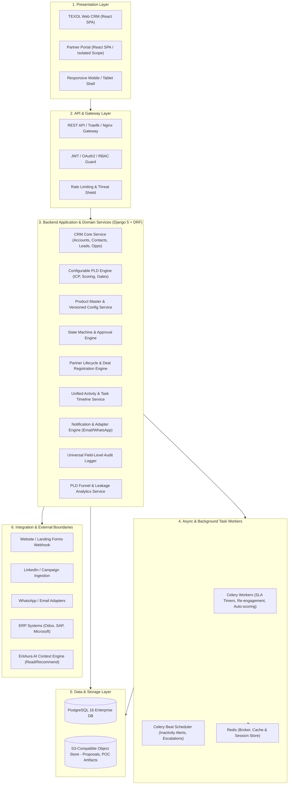
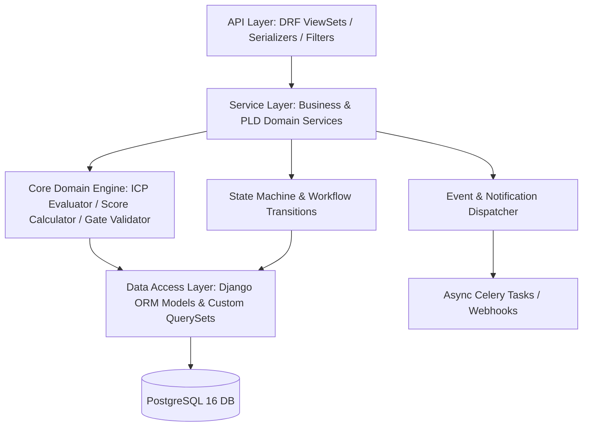
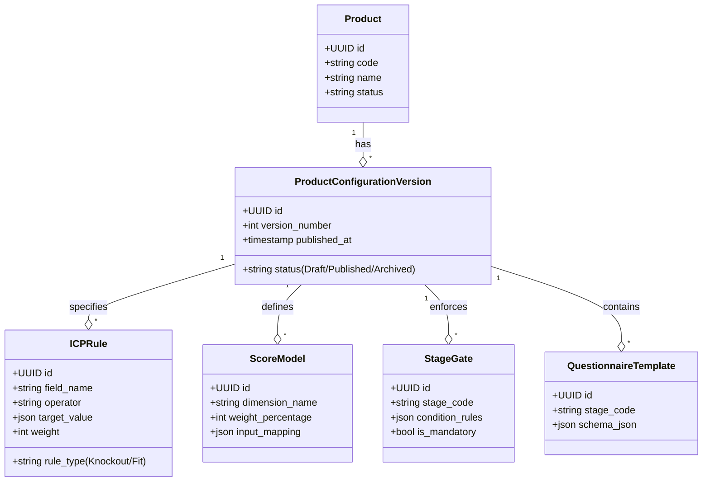
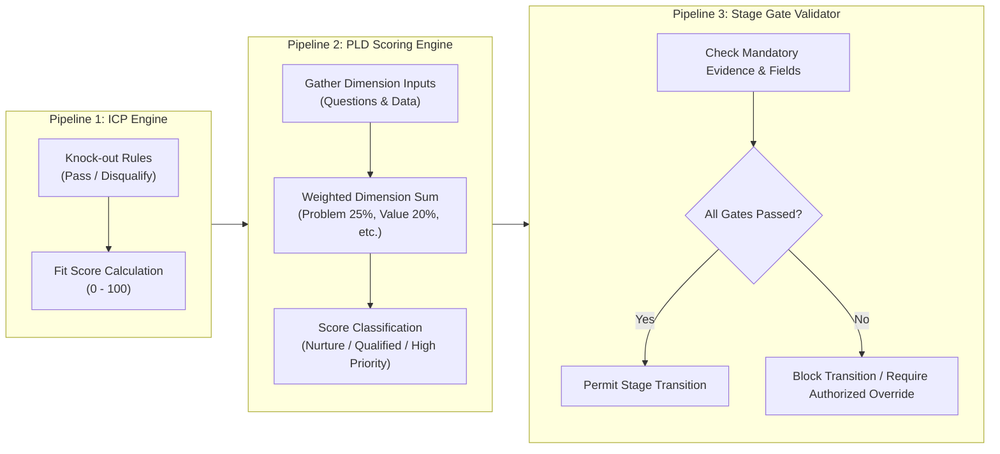
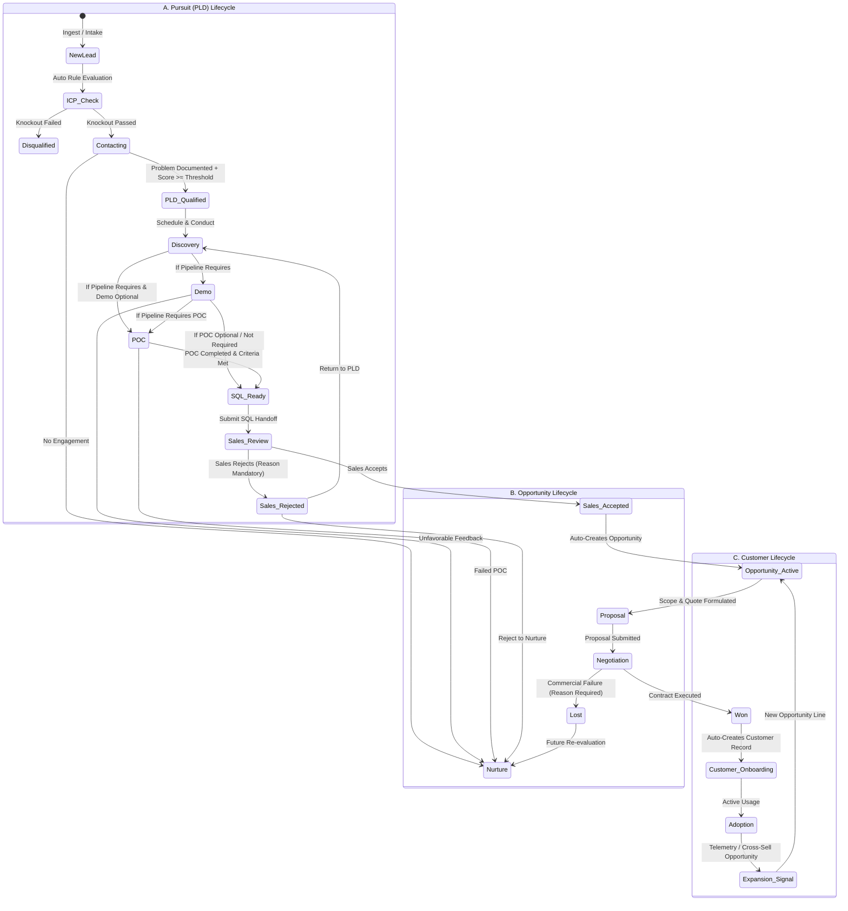

# TEXOL Configurable PLD CRM Platform
## Technical Foundation Plan & Architecture Specification
**Primary Source Documents:** *TEXOL Configurable PLD CRM Master Specification* & *TEXOL PLD CRM VanForces Functional & Technical Requirements v1.1*  
**Date:** October 2026 | **Version:** 1.0 — Architecture & Foundation Freeze  
**Guiding Principle:** **The CRM Core is 100% generic.** Products are configurations, never code branches or product-specific database tables. VanForces™ is the first product configuration.

---

## 1. System Architecture

### 1.1 Architectural Principles
1. **Generic Commercial Core vs. Dynamic PLD Engine**: Universal commercial entities (Accounts, Contacts, Leads, Opportunities, Activities, Partners) reside in CRM Core. Qualification rules, ICP criteria, problem definitions, capability mappings, scoring dimensions, and stage gates reside in the dynamic PLD Engine.
2. **Product as Configuration, Not Code**: No table shall ever be named `vanforces_lead`, `entaura_pld`, or contain hardcoded product columns (e.g. `van_count`). Product-specific attributes are handled via versioned configuration schemas and generic EAV/JSONB attribute models (`account_attribute`).
3. **Multi-Product First**: A single organization/account can hold multiple product relationships (prospect, evaluation, customer, expansion) simultaneously. A lead can express interest in multiple products. An opportunity can contain multi-product line items.
4. **Partner Organisation Multi-Tenancy Scope**: External partners authenticate into a shared platform but are strictly isolated server-side to their assigned organisation scope and authorised products.
5. **EntAura AI Boundary**: AI/ML services consume structured CRM context and event streams via secure APIs; transactional business rules and database integrity are enforced strictly by the backend core.

### 1.2 Multi-Tier Logical Architecture



---

## 2. Frontend Architecture

### 2.1 Technology Stack & Design System
* **Framework**: React 18+ with TypeScript (strict mode enabled).
* **Build System**: Vite (high performance, modern ESM bundling).
* **Styling & Theme**: Vanilla CSS / Tailwind CSS design system with an enterprise, high-contrast dark/light theme (Slate/Deep Blue palette) featuring glassmorphism accents, micro-animations, and strict WCAG 2.1 AA accessibility (color-blind friendly status indicators).
* **State Management**:
  * Server State & Caching: **TanStack Query (React Query v5)** for optimistic UI updates, background re-fetching, and cache invalidation.
  * Global UI State: **Zustand** for light client-side state (active product filter, work queue layout, drawer toggles).
* **Form Engine**: **React Hook Form** paired with **Zod** schema validation and a **Dynamic Form Renderer** that dynamically builds qualification forms from JSON-defined product questionnaire templates.
* **Component Primitives**: Radix UI / Headless UI for fully accessible dialogs, popovers, dropdowns, and tabs.
* **Icons & Visuals**: Lucide React.
* **Routing**: React Router v6 with nested route layouts and data loader guards.

### 2.2 Frontend Modular Architecture
```
frontend/
├── src/
│   ├── assets/                # Design tokens, global CSS, brand assets
│   ├── components/
│   │   ├── common/            # Button, Input, Modal, Badge, Dropdown, Table, EmptyState
│   │   ├── layout/            # AppShell, Sidebar, Header, Breadcrumbs, PartnerShell
│   │   ├── dynamic-forms/     # JSON-driven dynamic questionnaire & gate checklist components
│   │   ├── pld/               # ScoreBadge, DimensionBreakdown, GateCard, FunnelVisualizer
│   │   ├── timeline/          # Unified ActivityTimeline, NextActionBanner
│   │   └── audit/             # FieldChangeHistoryDrawer, DiffViewer
│   ├── features/
│   │   ├── dashboard/         # Executive, PLD, and Partner dashboard views
│   │   ├── accounts/          # Account360, AccountList, AccountProductList
│   │   ├── contacts/          # ContactDirectory, ContactCard
│   │   ├── leads/             # LeadQueue, LeadIntakeModal, LeadTouchList
│   │   ├── pld-qualification/ # LeadQualificationWorkspace, ICPCheckPanel, ProblemSelector
│   │   ├── discovery/         # DiscoveryWorkspace, ProblemMappingMatrix
│   │   ├── demo/              # DemoScheduler, DemoFeedbackModal, DemoList
│   │   ├── poc/               # POCTracker, KPIBaselineMatrix, POCResultModal
│   │   ├── sql-handoff/       # SQLReadinessGateChecklist, SalesAcceptanceModal
│   │   ├── opportunities/     # OpportunityPipelineKanban, OpportunityDetailWorkspace
│   │   ├── proposals/         # ProposalBuilder, VersionHistory, DiscountApprovalModal
│   │   ├── partners/          # PartnerDirectory, DealRegistrationForm, CommissionReport
│   │   └── product-config/    # ProductStudio, ICPRuleBuilder, ScoreModelEditor, GateManager
│   ├── hooks/                 # useAuth, usePLDScore, useGateValidator, useTenantScope
│   ├── services/api/          # Axios / Fetch client with interceptors and typed endpoint SDK
│   ├── store/                 # Zustand slices for UI and active context
│   └── types/                 # Shared TypeScript models generated from backend schemas
```

---

## 3. Backend Architecture

### 3.1 Technology Stack
* **Language & Framework**: Python 3.12+ with Django 5.x & Django REST Framework (DRF).
* **Database Driver**: `psycopg3` (native async support, connection pooling).
* **Task Queue**: Celery 5.x with Redis 7.x as message broker and result backend.
* **API Documentation**: `drf-spectacular` generating OpenAPI 3.1 / Swagger schemas.
* **Filtering & Search**: `django-filter` + PostgreSQL full-text search (`pg_trgm`).

### 3.2 Clean Layered Architecture


### 3.3 Dynamic Engine Strategy (Zero Hardcoded Product Logic)
To maintain 100% product-agnostic code:
* Product specifications are loaded into `ProductConfigurationVersion` records.
* The backend services load the active configuration version for the target product ID.
* ICP rules evaluate against Account and Lead data via a rule parser supporting operators: `EQUALS`, `NOT_EQUALS`, `GREATER_THAN`, `LESS_THAN`, `IN`, `CONTAINS`, `BETWEEN`.
* PLD scoring dynamically resolves dimension weights and value mapping functions from the DB-configured score model.
* Gate conditions are stored as structured rule definitions in `stage_gate.condition_rules` (JSONB) and validated deterministically before any stage progression is allowed.

---

## 4. PostgreSQL Database Architecture

### 4.1 Database Design Guidelines
1. **Primary Keys**: Universal `UUIDv4` primary keys across all domain entities (prevents enumeration attacks, simplifies distributed integration and partner isolation).
2. **Audit Timestamps**: All tables inherit from an abstract `TimeStampedModel` (`created_at`, `updated_at`, `created_by_id`, `updated_by_id`).
3. **Soft Deletion**: Business records utilize `is_deleted` and `deleted_at` fields to preserve audit history and foreign key referential integrity.
4. **Data Isolation (Tenant & Partner)**: Every domain table includes `tenant_id` (defaults to TEXOL internal tenant, ready for multi-tenancy) and partner-specific tables carry `partner_id` with foreign key indexes.
5. **JSONB with GIN Indexing**: Used for:
   * Dynamic product-specific attributes (`account_attribute.value_json`)
   * Rule definitions and gate conditions (`icp_rule.condition_json`, `stage_gate.condition_rules`)
   * Historical rule snapshots (`score_assessment.dimension_scores_snapshot`)
   * Field-level audit diffs (`audit_log.changes_json`)
6. **Indexing Strategy**:
   * B-tree indexes on foreign keys, status fields, timestamps, and owner IDs.
   * Composite indexes for frequent query pairs: `(account_id, product_id)`, `(stage_id, status)`, `(owner_id, next_activity_due)`.
   * Trigram indexes (`pg_trgm`) on company name, contact email, and phone for fast duplicate detection.

---

## 5. Complete Entity Relationship Diagram (ERD)

```mermaid
erDiagram
    TENANT ||--o{ USER : contains
    TENANT ||--o{ ACCOUNT : owns
    TENANT ||--o{ PRODUCT : owns

    USER ||--o{ ACCOUNT : manages
    USER ||--o{ LEAD : owns
    USER ||--o{ OPPORTUNITY : owns
    USER ||--o{ ACTIVITY : performs
    USER ||--o{ AUDIT_LOG : triggers

    ACCOUNT ||--o{ CONTACT : has
    ACCOUNT ||--o{ ACCOUNT_ATTRIBUTE : has_custom_attrs
    ACCOUNT ||--o{ ACCOUNT_PRODUCT : maintains_relationship
    ACCOUNT ||--o{ ACCOUNT_PRODUCT_ASSESSMENT : evaluated_by
    ACCOUNT ||--o{ LEAD : originates
    ACCOUNT ||--o{ OPPORTUNITY : holds
    ACCOUNT ||--o{ ACTIVITY : logs

    PRODUCT ||--o{ PRODUCT_MODULE : consists_of
    PRODUCT_MODULE ||--o{ PRODUCT_CAPABILITY : provides
    PRODUCT ||--o{ PRODUCT_CONFIGURATION_VERSION : versions
    PRODUCT_CONFIGURATION_VERSION ||--o{ ICP_RULE : defines
    PRODUCT_CONFIGURATION_VERSION ||--o{ SCORE_MODEL : defines
    PRODUCT_CONFIGURATION_VERSION ||--o{ QUESTIONNAIRE_TEMPLATE : defines
    PRODUCT_CONFIGURATION_VERSION ||--o{ PIPELINE_STAGE : configures
    PIPELINE_STAGE ||--o{ STAGE_GATE : enforces

    PROBLEM ||--o{ PROBLEM_CAPABILITY : maps_to
    PRODUCT_CAPABILITY ||--o{ PROBLEM_CAPABILITY : solves

    ACCOUNT_PRODUCT_ASSESSMENT ||--o{ SCORE_ASSESSMENT : itemizes
    ACCOUNT_PRODUCT_ASSESSMENT }o--|| PRODUCT_CONFIGURATION_VERSION : evaluated_against

    LEAD ||--o{ LEAD_PRODUCT_INTEREST : expresses
    PRODUCT ||--o{ LEAD_PRODUCT_INTEREST : targets
    LEAD ||--o{ LEAD_TOUCH : attributed_by
    CAMPAIGN ||--o{ LEAD_TOUCH : drives
    PARTNER ||--o{ LEAD_TOUCH : generates
    LEAD ||--o{ LEAD_PROBLEM : identifies
    PROBLEM ||--o{ LEAD_PROBLEM : categorizes

    LEAD ||--o{ DISCOVERY : progresses_to
    DISCOVERY ||--o{ DISCOVERY_PROBLEM : refines
    PROBLEM ||--o{ DISCOVERY_PROBLEM : details

    LEAD ||--o{ DEMO : schedules
    DISCOVERY ||--o{ DEMO : informs
    LEAD ||--o{ POC : tests
    DISCOVERY ||--o{ POC : defines

    LEAD ||--o{ SQL_HANDOFF : qualifies_into
    SQL_HANDOFF ||--o| OPPORTUNITY : converts_to

    OPPORTUNITY ||--o{ OPPORTUNITY_PRODUCT : contains
    PRODUCT ||--o{ OPPORTUNITY_PRODUCT : item
    OPPORTUNITY ||--o{ OPPORTUNITY_CAPABILITY : requires
    PRODUCT_CAPABILITY ||--o{ OPPORTUNITY_CAPABILITY : matches
    OPPORTUNITY ||--o{ PARTNER_INFLUENCE : influenced_by
    PARTNER ||--o{ PARTNER_INFLUENCE : influences
    OPPORTUNITY ||--o{ PROPOSAL : generates

    PARTNER ||--o{ PARTNER_USER : employs
    USER ||--o| PARTNER_USER : linked_to
    PARTNER ||--o{ PARTNER_PRODUCT : authorized_for
    PRODUCT ||--o{ PARTNER_PRODUCT : authorizes
    PARTNER ||--o{ DEAL_REGISTRATION : submits
    ACCOUNT ||--o{ DEAL_REGISTRATION : targets_account
    PRODUCT ||--o{ DEAL_REGISTRATION : targets_product

    STAGE_HISTORY }o--|| USER : changed_by
    APPROVAL }o--|| USER : requested_by
    APPROVAL }o--|| USER : approved_by
```



### 5.1 Detailed Table Schemas

#### Core Commercial Master
1. **`accounts`**: `id (UUID PK)`, `tenant_id`, `company_name`, `legal_name`, `trade_name`, `account_type (Prospect/Customer/Partner/Vendor)`, `industry`, `sub_industry`, `country`, `state`, `city`, `company_size_band`, `website`, `domain`, `phone`, `employees_count`, `distribution_centers_count`, `primary_owner_id (FK User)`, `is_deleted`, timestamps.
2. **`account_attributes`**: `id (UUID PK)`, `account_id (FK)`, `product_id (FK)`, `attribute_key (e.g. salesmen_count, van_count, outlet_count, sku_count, current_erp)`, `attribute_value_json (JSONB)`, timestamps.
3. **`contacts`**: `id (UUID PK)`, `account_id (FK)`, `first_name`, `last_name`, `designation`, `email`, `phone`, `mobile`, `linkedin_url`, `role_type (Decision Maker/Champion/Influencer/Technical/Finance/User)`, `decision_level`, `preferred_channel`, `is_primary`, `consent_status`, timestamps.
4. **`account_products`**: `id (UUID PK)`, `account_id (FK)`, `product_id (FK)`, `status (Prospect/Evaluation/Customer/Inactive/Expansion)`, `contract_value`, `arr_mrr`, `renewal_date`, `health_score`, timestamps. *(Unique: account_id, product_id)*.

#### Product Catalog & Dynamic PLD Configuration
5. **`products`**: `id (UUID PK)`, `code (e.g. VANFORCES, ENTAURA, TASKFORCES)`, `name`, `category`, `status (Draft/Internal/Active/Sunset/Archived)`, `owner_id (FK User)`, timestamps.
6. **`product_modules`**: `id (UUID PK)`, `product_id (FK)`, `name`, `code`, `description`, `is_active`, timestamps.
7. **`product_capabilities`**: `id (UUID PK)`, `product_id (FK)`, `module_id (FK)`, `name`, `code`, `description`, `is_active`, timestamps.
8. **`problems`**: `id (UUID PK)`, `code`, `category (Sales/Distribution/Management/Integration/Compliance)`, `name`, `description`, `default_severity`, timestamps.
9. **`problem_capabilities`**: `id (UUID PK)`, `problem_id (FK)`, `capability_id (FK)`, `expected_kpi_impact`, timestamps.
10. **`product_configuration_versions`**: `id (UUID PK)`, `product_id (FK)`, `version_number (e.g. 1, 2, 3)`, `status (Draft/Published/Archived)`, `published_at`, `published_by_id (FK User)`, timestamps.
11. **`icp_rules`**: `id (UUID PK)`, `config_version_id (FK)`, `rule_type (Knockout/Fit)`, `field_name`, `operator (EQ/NEQ/GT/LT/IN/CONTAINS)`, `target_value_json`, `weight`, `points`, `is_mandatory`, timestamps.
12. **`score_models`**: `id (UUID PK)`, `config_version_id (FK)`, `dimension_name (Problem Severity/Business Value/Decision Access/Timeline/Technical Fit/Commercial Potential)`, `weight_percentage`, `input_mapping_json`, timestamps.
13. **`questionnaire_templates`**: `id (UUID PK)`, `config_version_id (FK)`, `title`, `stage_code (PLD_QUALIFICATION/DISCOVERY)`, `schema_json (JSON-Schema of questions, types, feeds_dimension)`, timestamps.
14. **`pipeline_stages`**: `id (UUID PK)`, `config_version_id (FK)`, `pipeline_type (Pursuit/Opportunity/Customer)`, `stage_code`, `stage_name`, `sequence_order`, `is_required (True=Mandatory, False=Optional)`, timestamps.
15. **`stage_gates`**: `id (UUID PK)`, `pipeline_stage_id (FK)`, `gate_code`, `gate_name`, `condition_rules_json`, `is_mandatory`, timestamps.

#### Leads & Attribution
16. **`leads`**: `id (UUID PK)`, `account_id (FK)`, `contact_id (FK)`, `primary_product_id (FK)`, `source_id (FK LeadSource)`, `partner_id (FK Partner nullable)`, `owner_id (FK User)`, `current_stage_id (FK PipelineStage)`, `status (Active/Nurture/Disqualified/Converted)`, `nurture_reason`, `disqualification_reason`, `last_activity_at`, `next_activity_due_at`, `next_action_description`, timestamps.
17. **`lead_product_interests`**: `id (UUID PK)`, `lead_id (FK)`, `product_id (FK)`, `interest_level (High/Medium/Low)`, `is_primary`, `evidence_notes`, timestamps.
18. **`lead_touches`**: `id (UUID PK)`, `lead_id (FK)`, `campaign_id (FK nullable)`, `partner_id (FK nullable)`, `source_id (FK LeadSource)`, `touch_type (Inbound Form/LinkedIn/Email/Event/Direct Call)`, `touch_date`, `utm_parameters_json`, timestamps.
19. **`lead_problems`**: `id (UUID PK)`, `lead_id (FK)`, `problem_id (FK)`, `problem_notes`, timestamps.

#### PLD Assessments & Qualification
20. **`account_product_assessments`**: `id (UUID PK)`, `account_id (FK)`, `product_id (FK)`, `config_version_id (FK)`, `lead_id (FK nullable)`, `icp_knockout_status (Passed/Failed)`, `icp_fit_score (0-100)`, `pld_score (0-100)`, `score_classification (Nurture/Development/Qualified/High Priority)`, `assessed_at`, `assessed_by_id (FK User)`, timestamps.
21. **`score_assessments`**: `id (UUID PK)`, `assessment_id (FK)`, `dimension_name`, `input_value_json`, `raw_score`, `weighted_score`, `evidence_text`, timestamps.

#### Discovery, Evaluation, Demos & POCs
22. **`discoveries`**: `id (UUID PK)`, `lead_id (FK)`, `account_id (FK)`, `conducted_by_id (FK User)`, `current_process_notes`, `business_impact_summary`, `stakeholders_involved_notes`, `decision_process_notes`, `timeline_notes`, `budget_notes`, `technical_constraints_notes`, `is_product_mapping_complete`, timestamps.
23. **`discovery_problems`**: `id (UUID PK)`, `discovery_id (FK)`, `problem_id (FK)`, `lead_problem_id (FK nullable)`, `severity (High/Medium/Low)`, `frequency (Daily/Weekly/Monthly)`, `impact_description`, `quantified_loss_value`, timestamps.
24. **`demos`**: `id (UUID PK)`, `account_id (FK)`, `lead_id (FK)`, `discovery_id (FK nullable)`, `opportunity_id (FK nullable)`, `scheduled_at`, `conducted_at`, `presenter_id (FK User)`, `participants_notes`, `demonstrated_use_cases_json`, `customer_feedback`, `objections_raised`, `fit_assessment`, `next_action_due_at`, `status (Scheduled/Completed/Cancelled/Not Required)`, `not_required_reason`, timestamps.
25. **`pocs`**: `id (UUID PK)`, `account_id (FK)`, `lead_id (FK)`, `discovery_id (FK nullable)`, `opportunity_id (FK nullable)`, `owner_id (FK User)`, `scope_description`, `users_count`, `geography_coverage`, `start_date`, `end_date`, `success_criteria_json`, `baseline_metrics_json`, `result_metrics_json`, `status (Planned/Active/Review/Completed/Failed/Cancelled/Not Required)`, `not_required_reason`, timestamps.
26. **`sql_handoffs`**: `id (UUID PK)`, `lead_id (FK)`, `product_id (FK)`, `pld_executive_id (FK User)`, `assigned_sales_owner_id (FK User)`, `gate_audit_results_json`, `sla_expires_at`, `status (Pending/Accepted/Rejected)`, `decision_date`, `rejection_reason_notes`, timestamps.

#### Opportunities & Proposals
27. **`opportunities`**: `id (UUID PK)`, `account_id (FK)`, `primary_contact_id (FK)`, `owner_id (FK User)`, `sql_handoff_id (FK nullable)`, `type (New/Expansion/Renewal)`, `stage_id (FK PipelineStage)`, `status (Open/Won/Lost)`, `total_contract_value`, `arr_mrr`, `pricing_plan`, `seat_units_count`, `contract_term_months`, `currency (ISO 4217, e.g. USD, SAR, INR)`, `probability_pct`, `expected_close_date`, `loss_reason_category`, `loss_reason_notes`, timestamps.
28. **`opportunity_products`**: `id (UUID PK)`, `opportunity_id (FK)`, `product_id (FK)`, `quantity`, `unit_price`, `total_amount`, `term_months`, timestamps.
29. **`opportunity_capabilities`**: `id (UUID PK)`, `opportunity_id (FK)`, `capability_id (FK)`, timestamps.
30. **`partner_influences`**: `id (UUID PK)`, `opportunity_id (FK)`, `partner_id (FK)`, `influence_type (Originator/Sponsor/Co-Seller/Implementer)`, `influence_pct`, timestamps.
31. **`proposals`**: `id (UUID PK)`, `opportunity_id (FK)`, `version_number`, `proposal_document_url`, `gross_amount`, `discount_pct`, `net_amount`, `valid_until`, `status (Draft/Submitted/Approved/Rejected/Expired)`, `approval_required_flag`, timestamps.

#### Partner Framework
32. **`partners`**: `id (UUID PK)`, `account_id (FK Organization)`, `partner_code`, `partner_type (ERP Partner/SAP Partner/Odoo Partner/SI/Consultant/Referral)`, `territory`, `status (Prospect/Onboarding/Enabled/Authorised/Active/Suspended/Inactive)`, `partner_manager_id (FK User)`, timestamps.
33. **`partner_users`**: `id (UUID PK)`, `partner_id (FK)`, `user_id (FK User)`, `partner_role (Admin/Sales/Presales)`, `is_active`, timestamps.
34. **`partner_products`**: `id (UUID PK)`, `partner_id (FK)`, `product_id (FK)`, `authorization_status (Certified/Authorized/Under Evaluation)`, `territory`, `commission_rate_pct`, `valid_from`, `valid_to`, timestamps.
35. **`deal_registrations`**: `id (UUID PK)`, `partner_id (FK)`, `registered_by_user_id (FK User)`, `customer_account_id (FK Account)`, `product_id (FK)`, `expected_deal_value`, `evidence_notes`, `protection_expiry_date`, `status (Submitted/Under Review/Accepted/Rejected/Expired)`, `rejection_reason`, timestamps.
36. **`partner_commissions`**: `id (UUID PK)`, `partner_id (FK)`, `opportunity_id (FK)`, `deal_registration_id (FK nullable)`, `commission_amount`, `calculation_basis`, `payment_status (Accrued/Approved/Paid)`, `paid_at`, timestamps.

#### Cross-Cutting & Governance
37. **`activities`**: `id (UUID PK)`, `account_id (FK nullable)`, `lead_id (FK nullable)`, `opportunity_id (FK nullable)`, `activity_type (Call/Email/WhatsApp/Meeting/Discovery/Demo/POC/Follow-up/Site Visit/Partner Meeting)`, `subject`, `description_notes`, `conducted_at`, `due_date`, `outcome_notes`, `next_action_description`, `next_action_due_at`, `performed_by_id (FK User)`, timestamps.
38. **`tasks`**: `id (UUID PK)`, `assigned_to_id (FK User)`, `related_lead_id (FK nullable)`, `related_opportunity_id (FK nullable)`, `task_type (First Contact/Follow-up/Gate Missing/SLA Expiry/POC Review)`, `priority (Urgent/High/Medium/Low)`, `due_date`, `is_completed`, `completed_at`, timestamps.
39. **`stage_histories`**: `id (UUID PK)`, `record_type (Lead/Opportunity/POC/DealRegistration)`, `record_id (UUID)`, `from_stage_id (FK nullable)`, `to_stage_id (FK PipelineStage)`, `transition_reason`, `is_override`, `override_approved_by_id (FK User nullable)`, `changed_by_id (FK User)`, `created_at`.
40. **`approvals`**: `id (UUID PK)`, `record_type`, `record_id`, `approval_type (Stage Gate Override/Discount Exception/Score Override)`, `requested_by_id (FK User)`, `approver_id (FK User nullable)`, `status (Pending/Approved/Rejected)`, `justification_notes`, `decision_notes`, `decision_date`, timestamps.
41. **`audit_logs`**: `id (UUID PK)`, `actor_id (FK User nullable)`, `actor_email`, `actor_role`, `ip_address`, `entity_type`, `entity_id`, `action (CREATE/UPDATE/DELETE/GATE_OVERRIDE/LOGIN)`, `changes_json (diff of old vs new fields)`, `timestamp`.

---

## 6. Django App / Module Structure

The project will be organized inside `backend/` as clean, single-responsibility Django apps:

```
backend/
├── manage.py
├── config/
│   ├── settings/
│   │   ├── base.py
│   │   ├── local.py
│   │   └── production.py
│   ├── urls.py
│   ├── wsgi.py
│   └── asgi.py
├── apps/
│   ├── core/                        # Abstract models, UUID base, tenant context, utility validators
│   ├── authentication/              # Custom User, JWT tokens, RBAC permissions, Partner user profile
│   ├── accounts/                    # Accounts, Dynamic Account Attributes, Contacts, Account-Product states
│   ├── products/                    # Products, Modules, Capabilities, Problems, Problem-Capability mapping
│   ├── pld_engine/                  # Versioned Config, ICP Rules, Scoring Models, Dynamic Questionnaires
│   ├── leads/                       # Leads, Multi-product interest, Multi-touch attribution, Lead Problems
│   ├── discovery/                   # Discovery, Discovery Problems, Use-case mappings
│   ├── evaluations/                 # Demos, POCs/Pilots, KPI Baseline/Target tracking
│   ├── sales_handoff/               # SQL Gate evaluation, Sales Acceptance/Rejection workflow, SLAs
│   ├── opportunities/               # Opportunities, Multi-product lines, Capability demands, Proposals
│   ├── partners/                    # Partner Master, Authorizations, Deal Registrations, Commissions
│   ├── activities/                  # Unified Activity timeline, Tasks, Next-action alerts & escalations
│   ├── workflows/                   # State Machine definitions, Stage History, Approvals & Gate Overrides
│   ├── audit_logging/               # Automated signal/middleware audit tracker, field diff recorder
│   ├── notifications/               # In-app alerts, Celery workers, Email/WhatsApp provider adapters
│   ├── analytics/                   # Funnel calculations, leakage analysis, Executive KPI aggregation
│   └── integrations/                # Inbound webhooks (forms, LinkedIn), ERP adapter hooks, EntAura AI API
```

---

## 7. REST API Structure

All endpoints adhere to `/api/v1/` prefix with standardized JSON envelopes, pagination, and error representations.

### 7.1 Key Endpoints Matrix

| Area | HTTP Method | Endpoint | Purpose |
|---|---|---|---|
| **Auth & Profile** | `POST` | `/api/v1/auth/token/` | JWT token acquisition |
| | `GET` | `/api/v1/auth/me/` | Current user profile, permissions, partner scope |
| **Accounts** | `GET / POST` | `/api/v1/accounts/` | List/filter accounts, create account |
| | `GET / PUT / PATCH` | `/api/v1/accounts/{id}/` | Retrieve/update account |
| | `GET / POST` | `/api/v1/accounts/{id}/attributes/` | Get/upsert dynamic product attributes |
| | `GET` | `/api/v1/accounts/{id}/products/` | Multi-product relationships & status |
| **Contacts** | `GET / POST` | `/api/v1/contacts/` | List/create contacts |
| **Products & Config**| `GET` | `/api/v1/products/` | List active products |
| | `GET / POST` | `/api/v1/products/{id}/configurations/` | List or draft configuration versions |
| | `POST` | `/api/v1/products/{id}/configurations/{vid}/publish/` | Publish version (admin only) |
| | `GET` | `/api/v1/products/{id}/questionnaires/` | Fetch questionnaire template for stage |
| **Problems & Taxonomy**| `GET / POST` | `/api/v1/problems/` | Master problem library |
| | `GET` | `/api/v1/problems/mapping/` | Problem to capability mappings |
| **Leads & PLD** | `GET / POST` | `/api/v1/leads/` | Lead directory with PLD filter presets |
| | `POST` | `/api/v1/leads/intake/` | Public/webhook lead ingestion |
| | `GET / PUT` | `/api/v1/leads/{id}/product-interests/` | Manage multi-product interests |
| | `POST` | `/api/v1/leads/{id}/evaluate-icp/` | Trigger automatic ICP check |
| | `POST` | `/api/v1/leads/{id}/evaluate-pld-score/` | Submit questionnaire answers & get score |
| **Discovery** | `GET / POST` | `/api/v1/discoveries/` | Create or retrieve discovery workspace |
| | `POST` | `/api/v1/discoveries/{id}/problems/` | Link confirmed problems & impact |
| | `POST` | `/api/v1/discoveries/{id}/complete-mapping/`| Validate product mapping gate |
| **Demo & POC** | `GET / POST` | `/api/v1/demos/` | Schedule/log demo |
| | `POST` | `/api/v1/demos/{id}/complete/` | Complete demo with feedback & next action |
| | `POST` | `/api/v1/demos/{id}/mark-not-required/` | Skip demo with required reason |
| | `GET / POST` | `/api/v1/pocs/` | Plan/manage POC tracker |
| | `POST` | `/api/v1/pocs/{id}/complete/` | Record POC actuals & success assessment |
| **SQL Handoff** | `GET` | `/api/v1/leads/{id}/sql-gate-status/` | Inspect gate readiness checklist |
| | `POST` | `/api/v1/leads/{id}/mark-sql-ready/` | Validate gates and trigger handoff |
| | `POST` | `/api/v1/sql-handoffs/{id}/accept/` | Sales accept -> converts to Opportunity |
| | `POST` | `/api/v1/sql-handoffs/{id}/reject/` | Sales reject with reason -> returns to PLD |
| **Opportunities** | `GET / POST` | `/api/v1/opportunities/` | Opportunity list and pipeline Kanban |
| | `POST` | `/api/v1/opportunities/{id}/proposals/`| Generate/upload versioned proposal |
| | `POST` | `/api/v1/opportunities/{id}/transition-stage/` | Stage movement with gate enforcement |
| **Partners** | `GET / POST` | `/api/v1/partners/` | Manage partner directory |
| | `GET / POST` | `/api/v1/deal-registrations/` | Submit/review protected deal registration |
| | `POST` | `/api/v1/deal-registrations/{id}/decide/` | Accept / Reject registration |
| **Cross-Cutting** | `GET / POST` | `/api/v1/activities/` | Unified timeline logging |
| | `POST` | `/api/v1/approvals/{id}/decide/` | Approve/reject gate or discount exception |
| | `GET` | `/api/v1/analytics/funnel/` | PLD Funnel & leakage metrics |
| | `GET` | `/api/v1/audit/` | Filterable entity audit trail |
| **EntAura AI API** | `GET` | `/api/v1/ai/context/{entity_type}/{id}/` | Structured context extraction for LLM |

---

## 8. React Route Structure

### 8.1 Route Tree
```
/
├── login                                       # Authentication
├── unauthorized                                # Access Denied Screen
├── app/                                        # Internal TEXOL CRM Shell
│   ├── dashboard                               # Executive & Funnel Dashboard
│   ├── queue                                   # PLD Executive Work Queue
│   ├── accounts/
│   │   ├── :id                                 # Account 360 Workspace
│   │   └── index                               # Accounts Directory
│   ├── contacts/index                          # Contact Directory
│   ├── leads/
│   │   ├── :id/qualification                   # One-Screen PLD Qualification
│   │   ├── :id/discovery                       # Discovery & Problem Mapping
│   │   ├── :id/sql-readiness                   # SQL Gate Checklist & Handoff
│   │   └── index                               # Lead Queue & Intake
│   ├── demos/index                             # Demo Management & Schedules
│   ├── pocs/index                              # POC Tracker & KPI Baseline
│   ├── opportunities/
│   │   ├── pipeline                            # Opportunity Kanban Board
│   │   ├── :id                                 # Opportunity 360 & Proposal
│   │   └── index                               # Opportunity List
│   ├── partners/
│   │   ├── :id                                 # Partner 360 & Authorizations
│   │   └── index                               # Partner Network Management
│   ├── product-studio/
│   │   ├── :productId/versions                 # Configuration Version Manager
│   │   ├── :productId/icp                      # Knockout & Fit Rule Editor
│   │   ├── :productId/scoring                  # Dimension Weights & Point Editor
│   │   ├── :productId/gates                    # Pipeline Stage & Gate Editor
│   │   ├── :productId/questionnaire            # Dynamic Question Builder
│   │   └── index                               # Product Catalog
│   ├── analytics/
│   │   ├── funnel                              # PLD Funnel Leakage Analysis
│   │   └── attribution                         # Source / Campaign / Partner ROI
│   └── settings/
│       ├── users                               # User & Role Matrix
│       ├── approvals                           # Pending Gate/Discount Approvals
│       └── audit                               # Universal Audit Log Viewer
└── partner-portal/                             # Partner Portal (Scoped Shell)
    ├── dashboard                               # Partner Deal & Commission KPI
    ├── register-deal                           # Protected Deal Registration
    ├── my-deals                                # Registered Deals & Stage Status
    ├── enablement                              # Certified Products & Collateral
    └── activities                              # Partner Activity Log
```

---

## 9. Authentication and RBAC Architecture

### 9.1 User Roles Matrix
1. **Platform Admin**: Global system access, user management, configuration publishing, override approvals.
2. **TEXOL Management**: Global read visibility across all products, funnel analytics, revenue reports, executive approvals.
3. **Sales Manager**: Team/territory pipeline visibility, SQL acceptance monitoring, SLA escalations, discount approvals.
4. **Sales / BDM**: Assigned accounts/opportunities, SQL acceptance/rejection, proposal generation, commercial negotiations.
5. **PLD Executive**: Assigned leads, qualification questionnaires, problem documentation, discovery sessions, SQL readiness preparation.
6. **Solution Consultant (Presales)**: Discovery technical fit, demo execution, POC parameterization, KPI verification.
7. **Marketing**: Campaign management, lead source configuration, top-of-funnel intake, attribution analytics.
8. **Product Manager**: Product catalog ownership, ICP definition, problem/capability taxonomy, scoring model authoring.
9. **Customer Success**: Post-sale onboarding, account-product adoption tracking, expansion signal identification.
10. **Partner Manager**: Partner onboarding, product authorization, deal registration review, commission payouts.
11. **Partner User**: Strictly scoped to own partner organization: deal submission, tracking own leads/deals, collateral access.
12. **Finance / Operations**: Commercial reporting, margin checks, contract audits, commission validation.

### 9.2 Data Scoping & Row-Level Security
The system enforces 4 hierarchical data scoping tiers:
* **Global Scope**: Platform Admin, TEXOL Management.
* **Territory / Team Scope**: Sales Managers, Partner Managers.
* **Owner Scope**: Sales BDM, PLD Executives, Solution Consultants (see records where `owner_id == user.id` OR record is explicitly shared).
* **Partner Organisation Scope (Strict Tenant Isolation)**: Enforced via `PartnerScopedQuerySet` filtering `WHERE partner_id = request.user.partner_user.partner_id`. Partner users cannot see other partners' data, margins, or internal TEXOL notes.

---

## 10. Product Configuration Architecture



### 10.1 Versioning Lifecycle & Historical Reproducibility
* Product Managers modify rules in a **`Draft`** configuration version.
* Upon validation, clicking "Publish Version" transitions status to **`Published`** and sets prior versions to **`Archived`**.
* Whenever an ICP Check or PLD Score Assessment is executed, the record stores:
  * `product_id`
  * `config_version_id` (the exact immutable version used)
  * Dimension input values and resulting score points
* **Result**: Historical qualification scores remain 100% explainable and reproducible even if the product manager later rebalances weights.

---

## 11. PLD Engine Architecture

The PLD Engine operates as 3 discrete, chained evaluation pipelines:



### 11.1 ICP Engine Logic
1. **Knock-Out Check**: Evaluates binary criteria (e.g. Industry in allowed list, geography within supported territories). If any knockout rule fails, `icp_knockout_status = FAILED` and the record transitions to `Disqualified` or `Nurture`.
2. **Fit Score**: Non-knockout criteria (e.g. employee count, digital maturity) calculate a normalized 0–100 score.

### 11.2 PLD Scoring Engine
Calculates score across the 6 standard dimensions using active version weights (VanForces illustrative weights shown):
* Problem Severity (25%)
* Business Value (20%)
* Decision-Maker Access (15%)
* Timeline (10%)
* Technical Fit (15%)
* Commercial Potential (15%)
* **Score Output Classifications**:
  * `0–30`: **Nurture**
  * `31–60`: **PLD Development**
  * `61–80`: **Qualified PLD**
  * `81–100`: **High Priority**

*Key Architecture Rule*: **Scores determine priority; Stage Gates control progression.** A lead with score 90/100 still cannot advance without at least one documented business problem!

---

## 12. Workflow & State-Machine Architecture

The system models three separate, connected lifecycles:



### 12.1 Transition & Stage Gate Rules
1. **Backward Transitions**: Moving backwards (e.g. SQL Ready back to Discovery) requires a `transition_reason` captured in `stage_history`.
2. **Skipping Stages**:
   * If a stage is marked `is_required=False` in the product pipeline, the user can mark it "Not Required" with an explanatory reason.
   * If `is_required=True`, skipping requires an explicit `APPROVAL` record authorized by a Manager/Admin.
3. **Mandatory Next Action Rule**: No active commercial record can be saved without a valid `next_activity_due_at` and `next_action_description`.

---

## 13. Audit Architecture

### 13.1 Universal Audit Pattern
The audit architecture guarantees non-repudiation and enterprise traceability:
* **Mechanism**: Handled via Django model signals (`post_save`, `post_delete`) and a custom `AuditMiddleware` that injects the current `actor`, `ip_address`, and `user_agent` into thread-local context.
* **Tracked Changes**:
  * Entity Creation & Deletion
  * Field modifications: captures `{ field_name: { "old": old_val, "new": new_val } }`
  * Gate Overrides and Approvals
  * PLD Score Overrides and Re-evaluations
  * Ownership and Assignment changes
  * Deal Registration decisions
* **Immutability**: The `audit_logs` table has database-level write-once rules; updates and deletions are disabled for audit records.

---

## 14. Notification & Integration Architecture

### 14.1 Notification Architecture
* **In-App Alerts**: Real-time notifications via WebSocket / polling for SLA breaches, approvals, and high-score leads.
* **Adapter Pattern for Channels**:
  * Email Adapter: Pluggable interface (`EmailProvider`) supporting SMTP, SendGrid, and AWS SES.
  * WhatsApp Adapter: Pluggable interface (`WhatsAppProvider`) supporting Twilio, Infobip, and Meta Cloud API.

### 14.2 Integration Boundaries
1. **Inbound Webhooks**: Public endpoints for website inquiry forms and marketing campaign platforms (with signature verification).
2. **ERP Integration Gateway**: Inbound/outbound REST hooks for synchronizing customer master data and ERP presence signals.
3. **EntAura AI Boundary**: EntAura AI interacts exclusively via authenticated read endpoints (`/api/v1/ai/context/...`) and submits recommendations through an asynchronous queue. EntAura **never** executes direct un-audited transactional writes to the CRM.

---

## 15. Development Phases

| Phase | Milestone | Scope | Deliverables |
|---|---|---|---|
| **Phase 1** | **Core Foundation & PLD MVP** | Accounts, Contacts, Leads, Dynamic Product Config Master, ICP Engine, Problem Library, Questionnaire Engine, PLD Scoring, Discovery, Demo, SQL Handoff, Opportunity, Activity & Audit Trail | Usable end-to-end PLD CRM with VanForces as first product configuration |
| **Phase 2** | **Evaluation & Deal Lifecycle** | POC/Pilot tracker, Versioned Proposals, Discount Approvals, Partner Master, Partner Portal, Deal Registration, SLAs & Notifications | Complete commercial negotiation & partner collaboration |
| **Phase 3** | **Multi-Touch & Advanced Integrations** | Multi-touch campaign attribution, Email/WhatsApp adapters, ERP customer master sync, Advanced funnel leakage reports | Automated omni-channel tracking and ERP alignment |
| **Phase 4** | **EntAura AI & Telemetry** | EntAura context retrieval APIs, AI lead prioritization, discovery summarizer, next best action recommender, product telemetry ingestion | Closed-loop AI-assisted product-led growth |

---

## 16. Testing Strategy

### 16.1 Testing Pyramid & QA Layers
```
               [ E2E User Journeys (Playwright) ]
            [ Integration & API Contract Tests (Pytest) ]
         [ Domain Rule & Stage Gate Validation Tests (Pytest) ]
      [ Unit Tests: ICP, Scoring, Models, Serializers (Pytest) ]
```

### 16.2 Acceptance Test Matrix (from Specifications)
1. **AT-001 (Account Duplication)**: System checks domain/website; triggers warning and deduplication options.
2. **AT-002 (Multi-Product Interest)**: Lead can attach VanForces and TaskForces with independent primary flags and interest levels.
3. **AT-003 (Dynamic ICP Configuration)**: Admin alters ICP industry criteria in UI; new leads evaluate against revised rules without backend restart.
4. **AT-004 (PLD Score Repeatability)**: Identical questionnaire inputs yield exact score; dimension breakdown verified.
5. **AT-005 (Gate Enforcement)**: Attempting to mark SQL Ready without documented problem impact or timeline is rejected with HTTP 400.
6. **AT-006 (Sales Handoff SLA)**: SQL Ready record notifies sales owner; rejection returns lead to PLD with mandatory reason.
7. **AT-007 (Partner Tenant Isolation)**: Partner A user queries `/api/v1/leads/` and receives zero records belonging to Partner B or direct TEXOL leads.
8. **AT-008 (Deal Registration Conflict)**: Submitting deal registration for customer/product under existing protection triggers conflict review.
9. **AT-009 (Audit Completeness)**: Changing opportunity value or stage logs old and new value with user ID and timestamp in audit trail.
10. **AT-010 (Optional Stage Progression)**: When Demo is marked optional in product config, lead advances with reason "Not Required" without triggering approval override.

---

## 17. Open Decisions & Configuration Register
*In accordance with Section 23 of the specifications, all unresolved business items are categorized as `CONFIGURABLE / PENDING`:*

| Decision ID | Item | Specification Status | Architecture Implementation Strategy |
|---|---|---|---|
| **OD-01** | Multi-Tenant vs. Single-Org Multi-Product | **CONFIGURABLE / PENDING** | Database includes `tenant_id` on all tables from Day 1, defaulted to TEXOL internal tenant. Ready for multi-tenant activation without schema migration. |
| **OD-02** | Exact VanForces ICP Knockout vs Fit rules | **CONFIGURABLE / PENDING** | Implemented as DB configuration rows (`icp_rules`), fully editable by Admin via UI. |
| **OD-03** | Exact PLD Score Dimension Weights & Thresholds | **CONFIGURABLE / PENDING** | Implemented as DB configuration rows (`score_models`), versioned and editable. |
| **OD-04** | SQL Acceptance SLA Duration | **CONFIGURABLE / PENDING** | Parameterized in system configuration (default: 48 hours). |
| **OD-05** | Revenue Attribution Rule (First Touch / Last Touch / Registered Partner / Weighted) | **CONFIGURABLE / PENDING** | All touches captured in `lead_touches`; attribution engine implements pluggable strategy selectable by Admin. |
| **OD-06** | Partner Deal Protection Expiry Duration | **CONFIGURABLE / PENDING** | Configurable per partner tier (default: 90 days). |
| **OD-07** | WhatsApp & Email Provider Selection | **CONFIGURABLE / PENDING** | Abstract adapter pattern implemented; mock provider for development, ready for Twilio/SES. |
| **OD-08** | EntAura AI Read/Write Permissions Scope | **CONFIGURABLE / PENDING** | EntAura restricted to read-only API endpoints in Phase 1; action suggestions require human approval. |
| **OD-09** | Multilingual Scope (English vs Arabic) | **CONFIGURABLE / PENDING** | i18n support enabled in Django (`gettext`) and React (`i18next`); English first, RTL/Arabic strings ready. |

